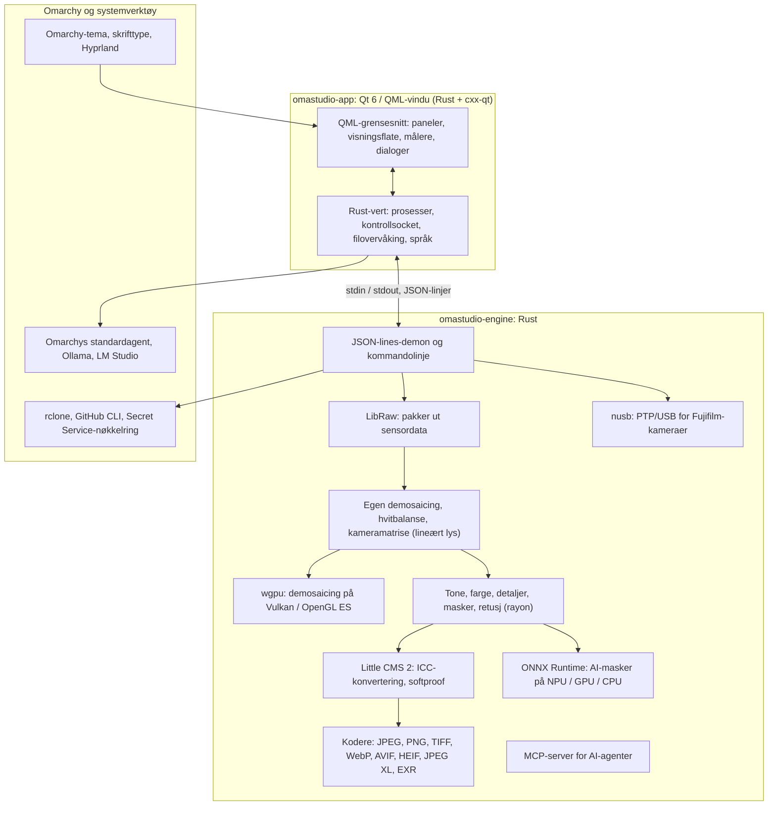

# Teknologier i OmaStudio

**OmaStudio: The Complete Medium Format RAW Editor for Omarchy**

[Alle språk](../README.md) · [Brukerveiledning](../guide/nb.md) · [README](../../README.md)

Denne siden beskriver teknologiene OmaStudio er bygd på: hva hver av dem gjør i programmet, hvorfor den ble valgt, og hvilken lisens den har. OmaStudio selv er utgitt under MIT-lisensen.

## Arkitektur

Vinduet og motoren er separate prosesser. Vinduet dekoder aldri et bilde selv: det sender kommandoer til motoren og viser bildene motoren skriver. Et krasj eller en låsing i dekodingen kan ikke ta grensesnittet med seg, og den samme motoren betjener kommandolinjen, skript og AI-agenter.

## Program

| Teknologi | Rolle i OmaStudio | Hvorfor | Lisens |
| :--- | :--- | :--- | :--- |
| **Rust** (1.99, edition 2024) | Språket for motoren og programverten | Minnesikkerhet for kode som tolker filer man ikke kan stole på, native hastighet og ett språk for begge prosessene | MIT / Apache-2.0 |
| **Qt 6** (6.12, Qt Quick / QML) | Grensesnittet: paneler, visningsflaten, målere, dialoger | GPU-tegnet grensesnitt med innebygd Wayland-støtte og brøkskalering, høyre-til-venstre-oppsett og oversettelsessystemet Qt Linguist | LGPL-3.0 |
| **cxx-qt** (0.10) | Kobler sammen Rust og Qt: verttypene `Process`, `Host` og kontrollsocketen er Rust-objekter som brukes fra QML | Trygge bindinger begge veier uten håndskrevet C++ | MIT / Apache-2.0 |
| **Qt Wayland** | Kjører vinduet som en innebygd Wayland-klient (app-id `omastudio`) | Omarchy kjører Hyprland på Wayland; Hyprlands vindusregler kan treffe app-id-en | LGPL-3.0 |
| **zenity** | Fil- og mappedialoger | Lite og finnes i alle Omarchy-installasjoner | LGPL-2.1+ |

QML-filene kompileres inn i binærfilen som Qt-ressurser, så en installert versjon blandes aldri med løse grensesnittfiler.

## RAW-motor

| Teknologi | Rolle i OmaStudio | Hvorfor | Lisens |
| :--- | :--- | :--- | :--- |
| **LibRaw** (0.22) | Leser RAW-containeren og pakker ut sensordata, metadata og innebygde forhåndsvisninger | Den bredeste kamerastøtten som finnes som bibliotek, inkludert Fujifilm GFX, Hasselblad, Phase One og Leaf | LGPL-2.1 eller CDDL-1.0 (dynamisk lenket) |
| **Egen fremkallingskjede** | Svartnivå, hvitbalanse, X-Trans- og Bayer-demosaicing, kameraets fargematrise, objektivkorrigeringer, alt på lineært lys | Kontroll over fargen fra sensoren og videre og en 16-biters vei til eksporten; demosaicingen velger mellom fire retningskandidater per piksel | MIT (OmaStudio) |
| **rayon** (1.12) | Parallell behandling på alle CPU-kjerner | Dataparallellisme uten håndskrevne trådsamlinger | MIT / Apache-2.0 |
| **wgpu** (30) | Demosaicing på GPU-en via Vulkan (NVIDIA, AMD, Intel, Qualcomm Adreno) eller OpenGL ES, i bånd som passer innenfor GPU-ens grenser | Én kodevei for alle GPU-produsenter, skrevet i WGSL; resultatet stemmer med CPU-veien innenfor ett nivå av 65535 | MIT / Apache-2.0 |
| **Little CMS 2** (via craten `lcms2`) | ICC-profiler, konvertering til eksportens fargerom, gjengivelsesmetoder, softproof og fargeomfangsvarselet | Referansemotoren for fargestyring med åpen kildekode | MIT |
| **image-rs**, **tiff**, **exr** | Leser og skriver PNG, JPEG, TIFF, WebP, OpenEXR, Radiance HDR og PNM | Kodeker i ren Rust med begrenset minnebruk | MIT / Apache-2.0; exr: BSD-3-Clause |
| **libjxl**, **libavif**, **libheif**, **libwebp** | Eksport til JPEG XL, AVIF, HEIF og WebP med tap | Referansekoderne for disse formatene | BSD-3-Clause, BSD-2-Clause, LGPL-3.0, BSD-3-Clause |
| **ExifTool** (valgfritt) | Overfører kameraets EXIF-metadata til eksporterte filer | Skriver metadata til alle formater OmaStudio eksporterer | Artistic / GPL (separat program) |
| **Lensfun-data** (valgfritt) | Objektivprofiler for mellomformatobjektiver | En stor, vedlikeholdt objektivdatabase som leses ved kjøring | Data CC BY-SA 3.0 |

Fargekjeden arbeider på lineært lys: eksponering er et fotografisk EV-steg, og hvitbalanse virker på lyset slik kameraets egne multiplikatorer gjør. Bildene kodes for skjerm én gang, før de kreative tone- og fargemodulene, og konverteres med Little CMS ved eksport.

## AI

| Teknologi | Rolle i OmaStudio | Hvorfor | Lisens |
| :--- | :--- | :--- | :--- |
| **ONNX Runtime** (via craten `ort`, lastes ved kjøring) | Kjører segmenteringsmodeller for maskene **AI-motiv** og **AI-himmel** | Ett kjøremiljø for NPU-er, GPU-er og CPU-er; valgfritt, så OmaStudio starter uten det | MIT |
| **Execution providers** | OpenVINO (Intel Core Ultra NPU), QNN (Snapdragon X NPU), Vitis AI (AMD Ryzen AI NPU), CUDA, MIGraphX, WebGPU, XNNPACK | Bruker maskinens raskeste akselerator og faller tilbake på CPU-en | Hver providers egen lisens |
| **Omarchys standardagent** (Claude Code eller Codex) | **Redigeringsassistent** og **KI-samtale** bruker agenten som er valgt med `omarchy-default-agent`, med egen pålogging | Ingen ekstra konto eller nøkkel i OmaStudio | Agentens egne vilkår |
| **Ollama**, **LM Studio** | Lokale bildemodeller for redigeringsassistenten | Bildene blir på datamaskinen | MIT; LM Studio: proprietær |
| **Skyleverandører** (Anthropic, OpenAI, OpenRouter, Google Gemini) | Valgfrie leverandører for redigeringsassistenten, nås med `curl` | Nøklene lagres i nøkkelringen og sendes via stdin, aldri på en kommandolinje | Leverandørens egne vilkår |
| **Model Context Protocol** | `omastudio mcp` lar AI-agenter undersøke, gjengi, eksportere og styre vinduet | En åpen protokoll som mange agenter støtter | Åpen spesifikasjon |

Assistentens svar begrenses til et JSON-skjema og holdes innenfor hver kontrolls område før det brukes, og hver endring kan angres.

## Kameraer

| Teknologi | Rolle i OmaStudio | Hvorfor | Lisens |
| :--- | :--- | :--- | :--- |
| **nusb** (0.2) | USB-tilgang for PTP-laget | Ren Rust, verken libusb eller gphoto2 trengs | MIT / Apache-2.0 |
| **PTP / Fujifilm-protokoll** | Egendefinerte innstillinger C1–C7, oppskrifter skrevet til kameraet, RAW-konvertering i kameraet | Dokumentert clean-room ut fra observasjon; ingen produsentkode | MIT (OmaStudio) |
| **udev-regel** | Gir den påloggede brukeren tilgang til Fujifilm-kameraer i PTP-modus | Ingen root trengs for å bruke et kamera | MIT (OmaStudio) |

## Skykontoer

| Teknologi | Rolle i OmaStudio | Hvorfor | Lisens |
| :--- | :--- | :--- | :--- |
| **rclone** | Google Drive, OneDrive, Dropbox, Box, pCloud og Yandex Disk: pålogging, blaing, nedlasting, opplasting | Én utprøvd klient for mange tjenester, med OAuth i nettleseren | MIT |
| **GitHub CLI** (`gh`) | GitHub-pålogging (device flow) og det private depotet `OmaStudio` | GitHubs egen klient; holder tokenet sitt i nøkkelringen | MIT |
| **libsecret** / Secret Service (`secret-tool`, `gnome-keyring`) | Oppbevarer nøkkelen til OmaStudios krypterte rclone-konfigurasjon og AI-leverandørenes nøkler | Hemmeligheter lagres aldri i klartekst | LGPL-2.1+ |

## Integrasjon med Omarchy

- **Tema.** Hver farge kommer fra det aktive Omarchy-temaet (`~/.local/state/omarchy/current/theme/colors.toml`) og endres med en gang når temaet byttes.
- **Skrifttype.** Grensesnittet bruker Omarchys skrifttype (`omarchy-font-set`, lest via fontconfig) og skalerer teksten ut fra grunnstørrelsen i Omarchy-skallet.
- **Hyprland.** Hjørnene følger Hyprlands avrunding; vinduet er en vanlig Wayland-klient med app-id `omastudio`.
- **Standardagent.** OmaStudio følger `~/.config/omarchy/defaults/agent` fortløpende.
- **Programmeny og linje.** Skrivebordsoppføringen bruker et monokromt ikon med høy kontrast, som Omarchys egne programmer; `Panel.qml` er en valgfri Quickshell-widget for Omarchy-linjen.
- **Språk.** Grensesnittet følger systemspråket (`LANGUAGE`, `LC_ALL`, `LC_MESSAGES`, `LANG`, `locale.conf`).

## Språk

| Teknologi | Rolle i OmaStudio | Lisens |
| :--- | :--- | :--- |
| **Qt Linguist** (`.ts`-filer, `lrelease`) | 30 grensesnittspråk, kompilert inn i binærfilen; høyre-til-venstre-oppsett for arabisk, hebraisk og persisk | LGPL-3.0 / GPL-3.0 (byggeverktøy) |
| **tools/i18n/check.py** | Får bygget i CI til å feile når en oversettelse mangler, står igjen på engelsk, har feil skriftsystem eller feil plassholdere | MIT (OmaStudio) |

## Bygg, test og utgivelse

| Teknologi | Rolle i OmaStudio | Lisens |
| :--- | :--- | :--- |
| **Cargo** med låst verktøykjede (`rust-toolchain.toml`) | Bygger motoren og programmet som ett arbeidsområde; `Cargo.lock` er sjekket inn | MIT / Apache-2.0 |
| **clang**, **pkgconf** | C-kompilator og linkerdriver for LibRaw-mellomlaget, finner biblioteker | Apache-2.0 med LLVM-unntak, ISC |
| **GitHub Actions** i en `archlinux`-container | Bygg, tester, `clippy -D warnings` og oversettelseskontrollen ved hver endring, med de samme pakkene som Omarchy bruker | — |
| **CodeQL** | Statisk analyse av Rust-koden og arbeidsflytene | — |
| **Utgivelsesarbeidsflyt** | Bygger arkivet ved en tagg og publiserer det med SHA-256-kontrollsummer og attesteringer av byggets opprinnelse | — |
| **PKGBUILD** | Arch-pakke med avhengigheter, valgfrie avhengigheter og udev-regelen | — |

## Sikkerhet

- Hvert eksterne program kjører med tømt miljø, egen prosessgruppe, en tidsgrense og en grense for utdata.
- Hver fil motoren leser, har en størrelsesgrense; katalog, innstillinger og sidefiler skrives atomisk med modus `0600`, og symbolske lenker avvises der motoren eier mappen.
- Kontrollsocketen ligger i `$XDG_RUNTIME_DIR/omastudio/` og svarer bare prosesser fra samme bruker (`SO_PEERCRED`).
- API-nøkler og skytokener blir i nøkkelringen og vises aldri på en kommandolinje.
- Grensesnittet viser all dynamisk tekst som ren tekst.

Detaljer står i [SECURITY.md](../../SECURITY.md).

## Varemerker

Fujifilm, GFX, X-Trans, Hasselblad, Phase One, Leica, Pentax, Mamiya og andre kameranavn er varemerker som tilhører sine eiere, og brukes bare for å beskrive kompatibilitet.
