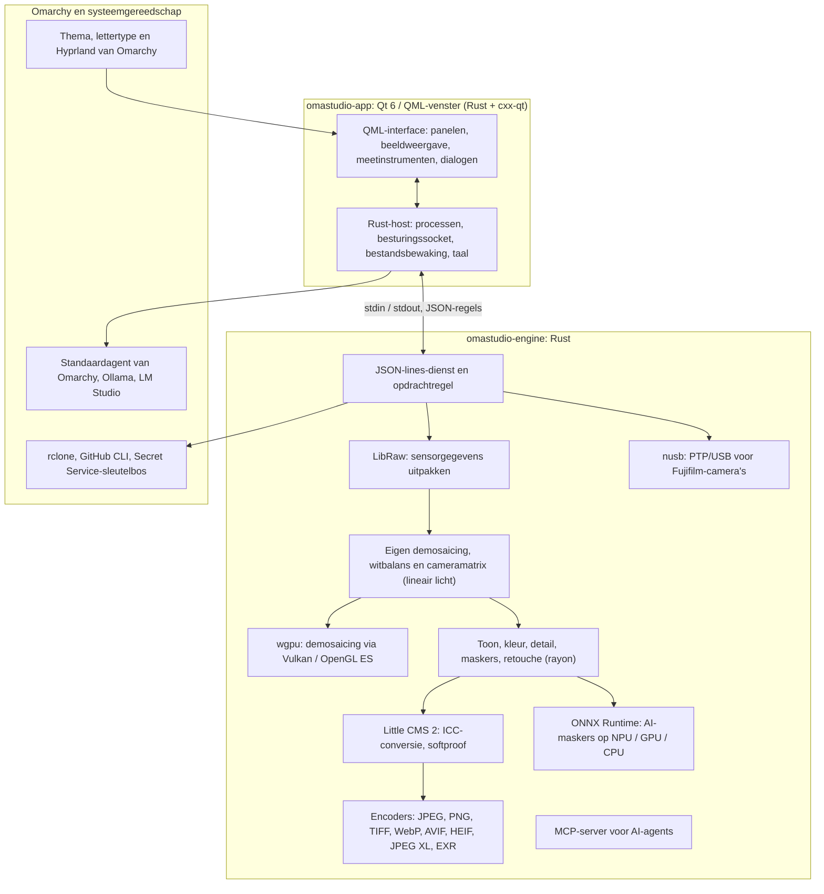

# Technologieën in OmaStudio

**OmaStudio: The Complete Medium Format RAW Editor for Omarchy**

[Alle talen](../README.md) · [Handleiding](../guide/nl.md) · [README](../../README.md)

Deze pagina beschrijft de technologieën waarop OmaStudio is gebouwd: wat elk ervan in de toepassing doet, waarom het is gekozen en onder welke licentie het valt. OmaStudio zelf valt onder de MIT-licentie.

## Architectuur

Het venster en de engine zijn afzonderlijke processen. Het venster decodeert nooit zelf een foto: het stuurt opdrachten naar de engine en toont de beelden die de engine schrijft. Een crash of vastloper tijdens het decoderen kan de interface niet meenemen, en dezelfde engine bedient de opdrachtregel, scripts en AI-agents.

## Toepassing

| Technologie | Rol in OmaStudio | Waarom | Licentie |
| :--- | :--- | :--- | :--- |
| **Rust** (1.99, editie 2024) | Taal van de engine en van de toepassingshost | Geheugenveiligheid voor code die onbetrouwbare bestanden leest, native snelheid en één taal voor beide processen | MIT / Apache-2.0 |
| **Qt 6** (6.12, Qt Quick / QML) | De interface: panelen, beeldweergave, meetinstrumenten, dialogen | Door de GPU getekende interface met native Wayland-ondersteuning en fractionele schaling, rechts-naar-links-indeling en het vertaalsysteem Qt Linguist | LGPL-3.0 |
| **cxx-qt** (0.10) | Verbindt Rust en Qt: de hosttypen `Process`, `Host` en de besturingssocket zijn Rust-objecten die QML gebruikt | Veilige koppelingen in beide richtingen zonder handgeschreven C++ | MIT / Apache-2.0 |
| **Qt Wayland** | Draait het venster als native Wayland-client (app-ID `omastudio`) | Omarchy draait Hyprland op Wayland; vensterregels van Hyprland kunnen op de app-ID filteren | LGPL-3.0 |
| **zenity** | Bestands- en mapdialogen | Klein en aanwezig op elke Omarchy-installatie | LGPL-2.1+ |

De QML-bestanden worden als Qt-resources in het programma gecompileerd, zodat een geïnstalleerde versie nooit vermengd raakt met losse interfacebestanden.

## RAW-engine

| Technologie | Rol in OmaStudio | Waarom | Licentie |
| :--- | :--- | :--- | :--- |
| **LibRaw** (0.22) | Leest de RAW-container en pakt sensorgegevens, metagegevens en ingebedde voorbeelden uit | De breedste cameraondersteuning die als bibliotheek beschikbaar is, waaronder Fujifilm GFX, Hasselblad, Phase One en Leaf | LGPL-2.1 of CDDL-1.0 (dynamisch gekoppeld) |
| **Eigen ontwikkelpijplijn** | Zwartniveau, witbalans, X-Trans- en Bayer-demosaicing, kleurmatrix van de camera, objectiefcorrecties, alles op lineair licht | Controle over kleur vanaf de sensor en een 16-bitsroute tot aan de export; de demosaicing kiest per pixel uit vier richtingskandidaten | MIT (OmaStudio) |
| **rayon** (1.12) | Parallelle verwerking op alle CPU-kernen | Dataparallellisme zonder handgeschreven threadpools | MIT / Apache-2.0 |
| **wgpu** (30) | Demosaicing op de GPU via Vulkan (NVIDIA, AMD, Intel, Qualcomm Adreno) of OpenGL ES, in stroken die binnen de grenzen van de GPU passen | Eén codepad voor elke GPU-fabrikant, geschreven in WGSL; het resultaat komt tot op één niveau van 65535 overeen met het CPU-pad | MIT / Apache-2.0 |
| **Little CMS 2** (via de crate `lcms2`) | ICC-profielen, conversie naar de exportkleurruimte, weergave-intenties, softproof en gamutwaarschuwing | De toonaangevende opensource-engine voor kleurbeheer | MIT |
| **image-rs**, **tiff**, **exr** | Lezen en schrijven van PNG, JPEG, TIFF, WebP, OpenEXR, Radiance HDR en PNM | Codecs in puur Rust met begrensd geheugengebruik | MIT / Apache-2.0; exr: BSD-3-Clause |
| **libjxl**, **libavif**, **libheif**, **libwebp** | Export naar JPEG XL, AVIF, HEIF en WebP met verlies | De referentie-encoders van deze formaten | BSD-3-Clause, BSD-2-Clause, LGPL-3.0, BSD-3-Clause |
| **ExifTool** (optioneel) | Neemt de EXIF-gegevens van de camera mee in geëxporteerde bestanden | Schrijft metagegevens in elk formaat dat OmaStudio exporteert | Artistic / GPL (apart programma) |
| **Lensfun-gegevens** (optioneel) | Objectiefprofielen voor middenformaatobjectieven | Een grote, onderhouden objectiefdatabase, tijdens het draaien gelezen | Gegevens CC BY-SA 3.0 |

De kleurpijplijn werkt op lineair licht: belichting is een fotografische EV-stap en de witbalans werkt op het licht zoals de eigen vermenigvuldigers van de camera. Beelden worden één keer voor weergave gecodeerd, vóór de creatieve toon- en kleurmodules, en bij export met Little CMS geconverteerd.

## AI

| Technologie | Rol in OmaStudio | Waarom | Licentie |
| :--- | :--- | :--- | :--- |
| **ONNX Runtime** (via de crate `ort`, tijdens het draaien geladen) | Draait segmentatiemodellen voor de maskers **AI-onderwerp** en **AI-lucht** | Eén runtime voor NPU's, GPU's en CPU's; optioneel, OmaStudio start ook zonder | MIT |
| **Execution providers** | OpenVINO (Intel Core Ultra-NPU), QNN (Snapdragon X-NPU), Vitis AI (AMD Ryzen AI-NPU), CUDA, MIGraphX, WebGPU, XNNPACK | Gebruikt de snelste versneller in de computer en valt terug op de CPU | Licentie van de betreffende provider |
| **Standaardagent van Omarchy** (Claude Code of Codex) | De bewerkingsassistent en het AI-gesprek gebruiken de agent die met `omarchy-default-agent` is gekozen, met zijn eigen aanmelding | Geen extra account of sleutel in OmaStudio | Voorwaarden van de agent |
| **Ollama**, **LM Studio** | Lokale beeldmodellen voor de bewerkingsassistent | Foto's blijven op de computer | MIT; LM Studio: propriëtair |
| **Cloudaanbieders** (Anthropic, OpenAI, OpenRouter, Google Gemini) | Optionele aanbieders voor de bewerkingsassistent, bereikt met `curl` | Sleutels staan in de sleutelbos en gaan via stdin, nooit op een opdrachtregel | Voorwaarden van de aanbieder |
| **Model Context Protocol** | `omastudio mcp` laat AI-agents foto's inspecteren, berekenen, exporteren en het venster besturen | Een open protocol dat veel agents ondersteunen | Open specificatie |

Het antwoord van de assistent is gebonden aan een JSON-schema en wordt vóór het toepassen begrensd tot het bereik van elke regelaar; elke bewerking kan ongedaan worden gemaakt.

## Camera's

| Technologie | Rol in OmaStudio | Waarom | Licentie |
| :--- | :--- | :--- | :--- |
| **nusb** (0.2) | USB-toegang voor de PTP-laag | Puur Rust, geen libusb of gphoto2 nodig | MIT / Apache-2.0 |
| **PTP / Fujifilm-protocol** | Eigen instellingen C1–C7, recepten die naar de camera worden geschreven, RAW-conversie in de camera | Clean-room gedocumenteerd op basis van waarneming; geen code van de fabrikant | MIT (OmaStudio) |
| **udev-regel** | Geeft de aangemelde gebruiker toegang tot Fujifilm-camera's in PTP-modus | Geen root nodig om een camera te gebruiken | MIT (OmaStudio) |

## Cloudaccounts

| Technologie | Rol in OmaStudio | Waarom | Licentie |
| :--- | :--- | :--- | :--- |
| **rclone** | Google Drive, OneDrive, Dropbox, Box, pCloud en Yandex Disk: aanmelden, bladeren, downloaden, uploaden | Eén beproefde client voor veel diensten, met OAuth in de browser | MIT |
| **GitHub CLI** (`gh`) | Aanmelden bij GitHub (device flow) en de privérepository `OmaStudio` | De eigen client van GitHub; bewaart zijn token in de sleutelbos | MIT |
| **libsecret** / Secret Service (`secret-tool`, `gnome-keyring`) | Bewaart de sleutel van de versleutelde rclone-configuratie van OmaStudio en de sleutels van AI-aanbieders | Geheimen worden nooit als platte tekst opgeslagen | LGPL-2.1+ |

## Integratie met Omarchy

- **Thema.** Elke kleur komt uit het actieve Omarchy-thema (`~/.local/state/omarchy/current/theme/colors.toml`) en verandert live mee als het thema wisselt.
- **Lettertype.** De interface gebruikt het lettertype van Omarchy (`omarchy-font-set`, gelezen via fontconfig) en schaalt tekst naar de basisgrootte van de Omarchy-shell.
- **Hyprland.** De hoeken volgen de afronding van Hyprland; het venster is een gewone Wayland-client met app-ID `omastudio`.
- **Standaardagent.** OmaStudio volgt `~/.config/omarchy/defaults/agent` live.
- **Toepassingsmenu en balk.** Het menu-item gebruikt een monochroom pictogram met hoog contrast, net als de toepassingen van Omarchy zelf; `Panel.qml` is een optionele Quickshell-widget voor de balk van Omarchy.
- **Taal.** De interface volgt de systeemtaal (`LANGUAGE`, `LC_ALL`, `LC_MESSAGES`, `LANG`, `locale.conf`).

## Talen

| Technologie | Rol in OmaStudio | Licentie |
| :--- | :--- | :--- |
| **Qt Linguist** (`.ts`-bestanden, `lrelease`) | 30 interfacetalen, in het programma gecompileerd; rechts-naar-links-indeling voor Arabisch, Hebreeuws en Perzisch | LGPL-3.0 / GPL-3.0 (buildgereedschap) |
| **tools/i18n/check.py** | Laat de build in CI mislukken als een vertaling ontbreekt, Engels is gebleven, in het verkeerde schrift staat of niet-overeenkomende plaatshouders heeft | MIT (OmaStudio) |

## Build, tests en release

| Technologie | Rol in OmaStudio | Licentie |
| :--- | :--- | :--- |
| **Cargo** met een vastgezette toolchain (`rust-toolchain.toml`) | Bouwt engine en toepassing als één workspace; `Cargo.lock` staat in de repository | MIT / Apache-2.0 |
| **clang**, **pkgconf** | C-compiler en linkerdriver voor de LibRaw-koppeling, bibliotheken vinden | Apache-2.0 met LLVM-uitzondering, ISC |
| **GitHub Actions** in een `archlinux`-container | Build, tests, `clippy -D warnings` en vertaalcontrole bij elke wijziging, met dezelfde pakketten als Omarchy | — |
| **CodeQL** | Statische analyse van de Rust-code en de workflows | — |
| **Releaseworkflow** | Bouwt het archief bij een tag en publiceert het met SHA-256-controlesommen en attestaties van de bouwherkomst | — |
| **PKGBUILD** | Arch-pakket met afhankelijkheden, optionele afhankelijkheden en de udev-regel | — |

## Beveiliging

- Elk extern programma draait met een leeggemaakte omgeving, in een eigen procesgroep, met een tijd- en uitvoerlimiet.
- Elk bestand dat de engine leest heeft een maximale grootte; catalogus, instellingen en sidecar-bestanden worden atomair geschreven met modus `0600`, en symbolische koppelingen worden geweigerd waar de map van de engine is.
- De besturingssocket staat in `$XDG_RUNTIME_DIR/omastudio/` en antwoordt alleen aan processen van dezelfde gebruiker (`SO_PEERCRED`).
- API-sleutels en cloudtokens blijven in de sleutelbos en verschijnen nooit op een opdrachtregel.
- De interface toont alle dynamische tekst als platte tekst.

Details staan in [SECURITY.md](../../SECURITY.md).

## Handelsmerken

Fujifilm, GFX, X-Trans, Hasselblad, Phase One, Leica, Pentax, Mamiya en andere cameranamen zijn handelsmerken van hun eigenaars en worden alleen gebruikt om compatibiliteit aan te geven.
