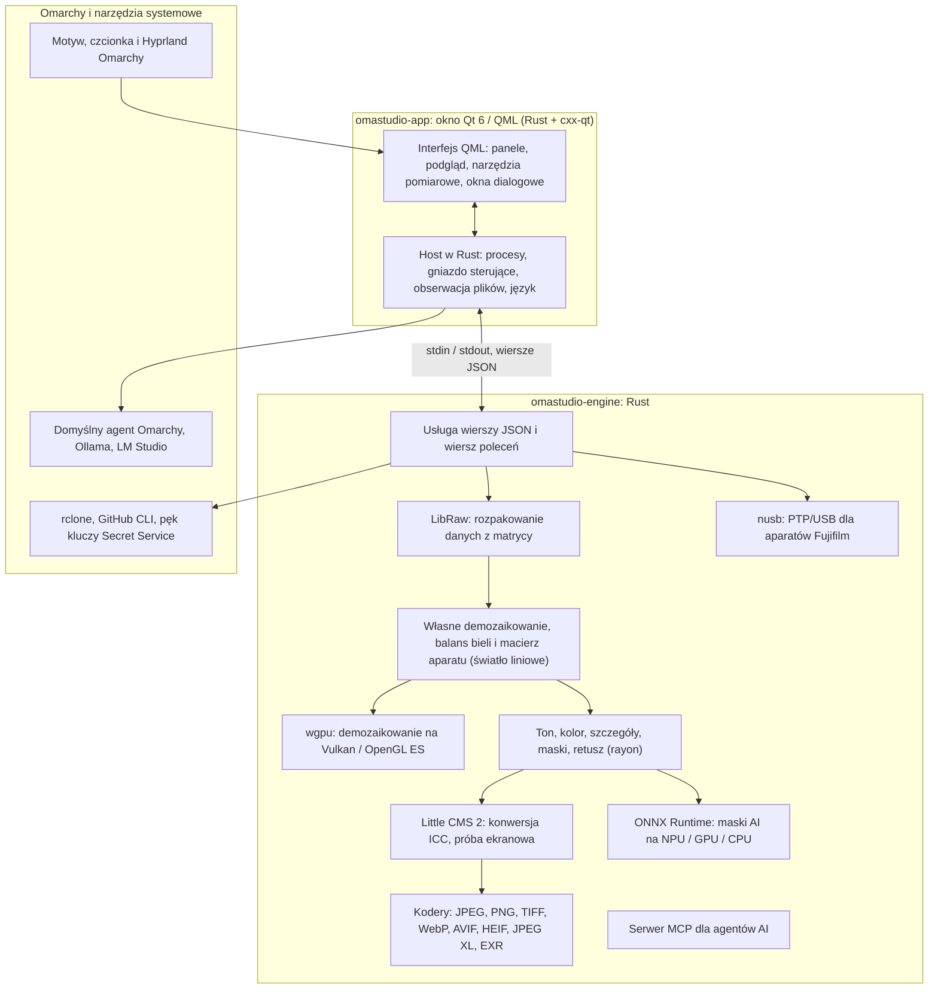

# Technologie w OmaStudio

**OmaStudio: The Complete Medium Format RAW Editor for Omarchy**

[Wszystkie języki](../README.md) · [Podręcznik użytkownika](../guide/pl.md) · [README](../../README.md)

Ta strona opisuje technologie, na których zbudowano OmaStudio: co każda z nich robi w aplikacji, dlaczego została wybrana i na jakiej licencji jest udostępniana. Samo OmaStudio jest wydane na licencji MIT.

## Architektura

Okno i silnik to osobne procesy. Okno nigdy samo nie dekoduje zdjęcia: wysyła polecenia do silnika i pokazuje obrazy, które silnik zapisuje. Awaria lub zawieszenie podczas dekodowania nie może pociągnąć za sobą interfejsu, a ten sam silnik obsługuje wiersz poleceń, skrypty i agentów AI.

## Aplikacja

| Technologia | Rola w OmaStudio | Dlaczego | Licencja |
| :--- | :--- | :--- | :--- |
| **Rust** (1.99, edycja 2024) | Język silnika i hosta aplikacji | Bezpieczeństwo pamięci dla kodu czytającego niezaufane pliki, natywna szybkość i jeden język dla obu procesów | MIT / Apache-2.0 |
| **Qt 6** (6.12, Qt Quick / QML) | Interfejs: panele, podgląd, narzędzia pomiarowe, okna dialogowe | Interfejs rysowany przez GPU z natywną obsługą Wayland i skalowania ułamkowego, układem od prawej do lewej i systemem tłumaczeń Qt Linguist | LGPL-3.0 |
| **cxx-qt** (0.10) | Łączy Rust i Qt: typy `Process`, `Host` i gniazdo sterujące to obiekty Rust używane w QML | Bezpieczne powiązania w obu kierunkach bez ręcznie pisanego C++ | MIT / Apache-2.0 |
| **Qt Wayland** | Uruchamia okno jako natywnego klienta Wayland (identyfikator aplikacji `omastudio`) | Omarchy używa Hyprland na Wayland; reguły okien Hyprland mogą korzystać z identyfikatora | LGPL-3.0 |
| **zenity** | Okna wyboru plików i folderów | Mały i obecny w każdej instalacji Omarchy | LGPL-2.1+ |

Pliki QML są kompilowane do pliku wykonywalnego jako zasoby Qt, dzięki czemu zainstalowana wersja nigdy nie miesza się z luźnymi plikami interfejsu.

## Silnik RAW

| Technologia | Rola w OmaStudio | Dlaczego | Licencja |
| :--- | :--- | :--- | :--- |
| **LibRaw** (0.22) | Czyta kontener RAW i rozpakowuje dane z matrycy, metadane i osadzone podglądy | Najszersza obsługa aparatów dostępna jako biblioteka, w tym Fujifilm GFX, Hasselblad, Phase One i Leaf | LGPL-2.1 lub CDDL-1.0 (łączona dynamicznie) |
| **Własny potok wywoływania** | Poziom czerni, balans bieli, demozaikowanie X-Trans i Bayer, macierz kolorów aparatu, korekcje obiektywu, wszystko na świetle liniowym | Kontrola koloru od matrycy i 16-bitowa ścieżka aż do eksportu; demozaikowanie wybiera dla każdego piksela jednego z czterech kandydatów kierunkowych | MIT (OmaStudio) |
| **rayon** (1.12) | Przetwarzanie równoległe na wszystkich rdzeniach CPU | Równoległość danych bez ręcznie pisanych pul wątków | MIT / Apache-2.0 |
| **wgpu** (30) | Demozaikowanie na GPU przez Vulkan (NVIDIA, AMD, Intel, Qualcomm Adreno) lub OpenGL ES, w pasach mieszczących się w limitach GPU | Jedna ścieżka kodu dla każdego producenta GPU, napisana w WGSL; wynik zgadza się ze ścieżką CPU z dokładnością do jednego poziomu na 65535 | MIT / Apache-2.0 |
| **Little CMS 2** (przez crate `lcms2`) | Profile ICC, konwersja do przestrzeni kolorów eksportu, metody odwzorowania, próba ekranowa i ostrzeżenie o gamucie | Wzorcowy silnik zarządzania kolorem o otwartym kodzie | MIT |
| **image-rs**, **tiff**, **exr** | Odczyt i zapis PNG, JPEG, TIFF, WebP, OpenEXR, Radiance HDR i PNM | Kodeki w czystym Rust z ograniczonym zużyciem pamięci | MIT / Apache-2.0; exr: BSD-3-Clause |
| **libjxl**, **libavif**, **libheif**, **libwebp** | Eksport do JPEG XL, AVIF, HEIF i stratnego WebP | Wzorcowe kodery tych formatów | BSD-3-Clause, BSD-2-Clause, LGPL-3.0, BSD-3-Clause |
| **ExifTool** (opcjonalnie) | Przenosi metadane EXIF aparatu do eksportowanych plików | Zapisuje metadane w każdym formacie, który eksportuje OmaStudio | Artistic / GPL (osobny program) |
| **Dane Lensfun** (opcjonalnie) | Profile obiektywów średnioformatowych | Duża, utrzymywana baza obiektywów, czytana w czasie działania | Dane CC BY-SA 3.0 |

Potok kolorów pracuje na świetle liniowym: ekspozycja to fotograficzny krok EV, a balans bieli działa na światło tak jak mnożniki samego aparatu. Obraz jest kodowany do wyświetlania tylko raz, przed twórczymi modułami tonu i koloru, a przy eksporcie konwertowany przez Little CMS.

## AI

| Technologia | Rola w OmaStudio | Dlaczego | Licencja |
| :--- | :--- | :--- | :--- |
| **ONNX Runtime** (przez crate `ort`, ładowany w czasie działania) | Uruchamia modele segmentacji dla masek **Obiekt (AI)** i **Niebo (AI)** | Jedno środowisko dla NPU, GPU i CPU; opcjonalne, OmaStudio uruchamia się także bez niego | MIT |
| **Dostawcy wykonania** | OpenVINO (NPU Intel Core Ultra), QNN (NPU Snapdragon X), Vitis AI (NPU AMD Ryzen AI), CUDA, MIGraphX, WebGPU, XNNPACK | Używa najszybszego akceleratora w komputerze, a w razie potrzeby CPU | Licencja danego dostawcy |
| **Domyślny agent Omarchy** (Claude Code lub Codex) | Asystent edycji i czat z SI używają agenta wybranego przez `omarchy-default-agent`, z jego własnym logowaniem | Bez dodatkowego konta ani klucza w OmaStudio | Warunki agenta |
| **Ollama**, **LM Studio** | Lokalne modele wizyjne dla asystenta edycji | Zdjęcia zostają na komputerze | MIT; LM Studio: zastrzeżona |
| **Dostawcy w chmurze** (Anthropic, OpenAI, OpenRouter, Google Gemini) | Opcjonalni dostawcy dla asystenta edycji, osiągani przez `curl` | Klucze są w pęku kluczy i przekazywane przez stdin, nigdy w wierszu poleceń | Warunki dostawcy |
| **Model Context Protocol** | `omastudio mcp` pozwala agentom AI badać, przetwarzać, eksportować zdjęcia i sterować oknem | Otwarty protokół obsługiwany przez wielu agentów | Otwarta specyfikacja |

Odpowiedź asystenta jest ograniczona schematem JSON i przed zastosowaniem przycinana do zakresu każdej kontrolki; każdą edycję można cofnąć.

## Aparaty

| Technologia | Rola w OmaStudio | Dlaczego | Licencja |
| :--- | :--- | :--- | :--- |
| **nusb** (0.2) | Dostęp do USB dla warstwy PTP | Czysty Rust, bez libusb i gphoto2 | MIT / Apache-2.0 |
| **PTP / protokół Fujifilm** | Ustawienia własne C1–C7, przepisy zapisywane w aparacie, konwersja RAW w aparacie | Udokumentowany metodą clean room na podstawie obserwacji; bez kodu producenta | MIT (OmaStudio) |
| **Reguła udev** | Daje zalogowanemu użytkownikowi dostęp do aparatów Fujifilm w trybie PTP | Do pracy z aparatem nie potrzeba roota | MIT (OmaStudio) |

## Konta w chmurze

| Technologia | Rola w OmaStudio | Dlaczego | Licencja |
| :--- | :--- | :--- | :--- |
| **rclone** | Google Drive, OneDrive, Dropbox, Box, pCloud i Yandex Disk: logowanie, przeglądanie, pobieranie, przesyłanie | Jeden sprawdzony klient dla wielu usług, z OAuth w przeglądarce | MIT |
| **GitHub CLI** (`gh`) | Logowanie do GitHuba (device flow) i prywatne repozytorium `OmaStudio` | Własny klient GitHuba; przechowuje token w pęku kluczy | MIT |
| **libsecret** / Secret Service (`secret-tool`, `gnome-keyring`) | Przechowuje klucz zaszyfrowanej konfiguracji rclone OmaStudio i klucze dostawców AI | Sekrety nigdy nie są przechowywane jawnym tekstem | LGPL-2.1+ |

## Integracja z Omarchy

- **Motyw.** Każdy kolor pochodzi z aktywnego motywu Omarchy (`~/.local/state/omarchy/current/theme/colors.toml`) i zmienia się na bieżąco wraz ze zmianą motywu.
- **Czcionka.** Interfejs używa czcionki Omarchy (`omarchy-font-set`, odczytywanej przez fontconfig) i skaluje tekst według rozmiaru bazowego powłoki Omarchy.
- **Hyprland.** Narożniki podążają za zaokrągleniem Hyprland; okno jest zwykłym klientem Wayland z identyfikatorem `omastudio`.
- **Domyślny agent.** OmaStudio na bieżąco śledzi `~/.config/omarchy/defaults/agent`.
- **Menu aplikacji i pasek.** Wpis w menu ma kontrastową, jednobarwną ikonę, jak aplikacje samego Omarchy; `Panel.qml` to opcjonalny widżet Quickshell dla paska Omarchy.
- **Język.** Interfejs podąża za językiem systemu (`LANGUAGE`, `LC_ALL`, `LC_MESSAGES`, `LANG`, `locale.conf`).

## Języki

| Technologia | Rola w OmaStudio | Licencja |
| :--- | :--- | :--- |
| **Qt Linguist** (pliki `.ts`, `lrelease`) | 30 języków interfejsu skompilowanych do pliku wykonywalnego; układ od prawej do lewej dla arabskiego, hebrajskiego i perskiego | LGPL-3.0 / GPL-3.0 (narzędzie budowania) |
| **tools/i18n/check.py** | Przerywa budowanie w CI, gdy brakuje tłumaczenia, zostało ono po angielsku, użyto złego pisma lub symbole zastępcze się nie zgadzają | MIT (OmaStudio) |

## Budowanie, testy i wydania

| Technologia | Rola w OmaStudio | Licencja |
| :--- | :--- | :--- |
| **Cargo** z przypiętym zestawem narzędzi (`rust-toolchain.toml`) | Buduje silnik i aplikację jako jeden obszar roboczy; `Cargo.lock` jest w repozytorium | MIT / Apache-2.0 |
| **clang**, **pkgconf** | Kompilator C i sterownik konsolidatora dla warstwy LibRaw, wyszukiwanie bibliotek | Apache-2.0 z wyjątkiem LLVM, ISC |
| **GitHub Actions** w kontenerze `archlinux` | Budowanie, testy, `clippy -D warnings` i sprawdzanie tłumaczeń przy każdej zmianie, z tymi samymi pakietami, których używa Omarchy | — |
| **CodeQL** | Analiza statyczna kodu w Rust i przepływów pracy | — |
| **Przepływ wydania** | Buduje archiwum po utworzeniu tagu i publikuje je z sumami kontrolnymi SHA-256 i poświadczeniami pochodzenia | — |
| **PKGBUILD** | Pakiet Arch z zależnościami, zależnościami opcjonalnymi i regułą udev | — |

## Bezpieczeństwo

- Każdy zewnętrzny program działa z wyczyszczonym środowiskiem, we własnej grupie procesów, z limitem czasu i wyjścia.
- Każdy plik, który czyta silnik, ma limit rozmiaru; katalog, ustawienia i pliki pomocnicze są zapisywane atomowo z trybem `0600`, a dowiązania symboliczne są odrzucane tam, gdzie folder należy do silnika.
- Gniazdo sterujące znajduje się w `$XDG_RUNTIME_DIR/omastudio/` i odpowiada tylko procesom tego samego użytkownika (`SO_PEERCRED`).
- Klucze API i tokeny chmury pozostają w pęku kluczy i nigdy nie pojawiają się w wierszu poleceń.
- Interfejs wyświetla cały dynamiczny tekst jako zwykły tekst.

Szczegóły znajdują się w [SECURITY.md](../../SECURITY.md).

## Znaki towarowe

Fujifilm, GFX, X-Trans, Hasselblad, Phase One, Leica, Pentax, Mamiya i inne nazwy aparatów są znakami towarowymi ich właścicieli i są używane wyłącznie do określenia zgodności.
