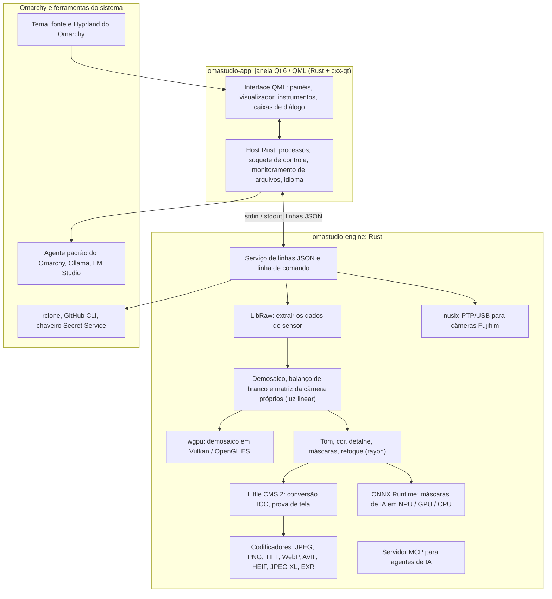

# Tecnologias do OmaStudio

**OmaStudio: The Complete Medium Format RAW Editor for Omarchy**

[Todos os idiomas](../README.md) · [Guia do usuário](../guide/pt_BR.md) · [README](../../README.md)

Esta página descreve as tecnologias em que o OmaStudio se baseia: o que cada uma faz no aplicativo, por que foi escolhida e qual é a sua licença. O OmaStudio é distribuído sob a licença MIT.

## Arquitetura

A janela e o motor são processos separados. A janela nunca decodifica uma foto sozinha: ela envia comandos ao motor e mostra as imagens que o motor grava. Uma falha ou um travamento na decodificação não derruba a interface, e o mesmo motor atende a linha de comando, os scripts e os agentes de IA.

## Aplicativo

| Tecnologia | Papel no OmaStudio | Por quê | Licença |
| :--- | :--- | :--- | :--- |
| **Rust** (1.99, edição 2024) | Linguagem do motor e do host do aplicativo | Segurança de memória para código que lê arquivos não confiáveis, velocidade nativa e uma só linguagem para os dois processos | MIT / Apache-2.0 |
| **Qt 6** (6.12, Qt Quick / QML) | A interface: painéis, visualizador, instrumentos, caixas de diálogo | Interface desenhada pela GPU, com suporte nativo a Wayland e escala fracionária, layout da direita para a esquerda e o sistema de tradução Qt Linguist | LGPL-3.0 |
| **cxx-qt** (0.10) | Liga Rust e Qt: os tipos `Process`, `Host` e o soquete de controle são objetos Rust usados no QML | Ligações seguras nos dois sentidos, sem C++ escrito à mão | MIT / Apache-2.0 |
| **Qt Wayland** | Executa a janela como cliente Wayland nativo (ID do aplicativo `omastudio`) | O Omarchy usa Hyprland sobre Wayland; as regras de janela do Hyprland podem usar o ID | LGPL-3.0 |
| **zenity** | Caixas de diálogo de arquivos e pastas | Pequeno e presente em toda instalação do Omarchy | LGPL-2.1+ |

Os arquivos QML são compilados no binário como recursos do Qt, de modo que uma versão instalada nunca se mistura com arquivos de interface soltos.

## Motor RAW

| Tecnologia | Papel no OmaStudio | Por quê | Licença |
| :--- | :--- | :--- | :--- |
| **LibRaw** (0.22) | Lê o contêiner RAW e extrai os dados do sensor, os metadados e as prévias incorporadas | O suporte a câmeras mais amplo disponível como biblioteca, incluindo Fujifilm GFX, Hasselblad, Phase One e Leaf | LGPL-2.1 ou CDDL-1.0 (ligação dinâmica) |
| **Pipeline de revelação própria** | Nível de preto, balanço de branco, demosaico X-Trans e Bayer, matriz de cor da câmera, correções de lente, tudo sobre luz linear | Controle da cor desde o sensor e um caminho de 16 bits até a exportação; o demosaico escolhe, por pixel, entre quatro candidatos direcionais | MIT (OmaStudio) |
| **rayon** (1.12) | Processamento paralelo em todos os núcleos da CPU | Paralelismo de dados sem pools de threads escritos à mão | MIT / Apache-2.0 |
| **wgpu** (30) | Demosaico na GPU via Vulkan (NVIDIA, AMD, Intel, Qualcomm Adreno) ou OpenGL ES, em faixas que cabem nos limites da GPU | Um só caminho de código para todos os fabricantes de GPU, escrito em WGSL; o resultado coincide com o caminho da CPU com diferença de até um nível em 65535 | MIT / Apache-2.0 |
| **Little CMS 2** (pelo crate `lcms2`) | Perfis ICC, conversão para o espaço de cor de exportação, tipos de renderização, prova de tela e aviso de gama | O motor de gerenciamento de cor de código aberto de referência | MIT |
| **image-rs**, **tiff**, **exr** | Leitura e gravação de PNG, JPEG, TIFF, WebP, OpenEXR, Radiance HDR e PNM | Codecs em Rust puro com uso de memória limitado | MIT / Apache-2.0; exr: BSD-3-Clause |
| **libjxl**, **libavif**, **libheif**, **libwebp** | Exportação em JPEG XL, AVIF, HEIF e WebP com perdas | Os codificadores de referência desses formatos | BSD-3-Clause, BSD-2-Clause, LGPL-3.0, BSD-3-Clause |
| **ExifTool** (opcional) | Leva os metadados EXIF da câmera para os arquivos exportados | Grava metadados em todos os formatos que o OmaStudio exporta | Artistic / GPL (programa separado) |
| **Dados do Lensfun** (opcional) | Perfis de lentes de médio formato | Um banco de dados de lentes grande e mantido, lido em tempo de execução | Dados CC BY-SA 3.0 |

A pipeline de cor trabalha em luz linear: a exposição é um passo fotográfico em EV, e o balanço de branco atua sobre a luz como os multiplicadores da própria câmera. As imagens são codificadas para a tela uma única vez, antes dos módulos criativos de tom e cor, e convertidas com o Little CMS na exportação.

## IA

| Tecnologia | Papel no OmaStudio | Por quê | Licença |
| :--- | :--- | :--- | :--- |
| **ONNX Runtime** (pelo crate `ort`, carregado em tempo de execução) | Executa os modelos de segmentação das máscaras **Assunto (IA)** e **Céu (IA)** | Um só runtime para NPUs, GPUs e CPUs; opcional, o OmaStudio abre sem ele | MIT |
| **Provedores de execução** | OpenVINO (NPU Intel Core Ultra), QNN (NPU Snapdragon X), Vitis AI (NPU AMD Ryzen AI), CUDA, MIGraphX, WebGPU, XNNPACK | Usa o acelerador mais rápido do computador e recorre à CPU | Licença de cada provedor |
| **Agente padrão do Omarchy** (Claude Code ou Codex) | O assistente de edição e a conversa com IA usam o agente escolhido com `omarchy-default-agent`, com o próprio login | Nenhuma conta ou chave extra no OmaStudio | Termos do agente |
| **Ollama**, **LM Studio** | Modelos de visão locais para o assistente de edição | As fotos ficam no computador | MIT; LM Studio: proprietário |
| **Provedores na nuvem** (Anthropic, OpenAI, OpenRouter, Google Gemini) | Provedores opcionais para o assistente de edição, acessados com `curl` | As chaves ficam no chaveiro e são passadas por stdin, nunca em uma linha de comando | Termos do provedor |
| **Model Context Protocol** | `omastudio mcp` permite que agentes de IA inspecionem, renderizem, exportem e controlem a janela | Um protocolo aberto compatível com muitos agentes | Especificação aberta |

A resposta do assistente é limitada por um esquema JSON e ajustada à faixa de cada controle antes de ser aplicada, e cada edição pode ser desfeita.

## Câmeras

| Tecnologia | Papel no OmaStudio | Por quê | Licença |
| :--- | :--- | :--- | :--- |
| **nusb** (0.2) | Acesso USB para a camada PTP | Rust puro, sem libusb nem gphoto2 | MIT / Apache-2.0 |
| **PTP / protocolo da Fujifilm** | Ajustes personalizados C1–C7, receitas gravadas na câmera, conversão RAW na câmera | Documentado em sala limpa a partir de observação; sem código do fabricante | MIT (OmaStudio) |
| **Regra udev** | Dá ao usuário conectado acesso às câmeras Fujifilm no modo PTP | Não é preciso root para usar uma câmera | MIT (OmaStudio) |

## Contas na nuvem

| Tecnologia | Papel no OmaStudio | Por quê | Licença |
| :--- | :--- | :--- | :--- |
| **rclone** | Google Drive, OneDrive, Dropbox, Box, pCloud e Yandex Disk: login, navegação, download e envio | Um cliente testado para muitos serviços, com OAuth no navegador | MIT |
| **GitHub CLI** (`gh`) | Login no GitHub (device flow) e o repositório privado `OmaStudio` | O cliente oficial do GitHub; guarda o token no chaveiro | MIT |
| **libsecret** / Secret Service (`secret-tool`, `gnome-keyring`) | Guarda a chave da configuração criptografada do rclone do OmaStudio e as chaves dos provedores de IA | Segredos nunca são guardados em texto puro | LGPL-2.1+ |

## Integração com o Omarchy

- **Tema.** Cada cor vem do tema ativo do Omarchy (`~/.local/state/omarchy/current/theme/colors.toml`) e muda ao vivo quando o tema muda.
- **Fonte.** A interface usa a fonte do Omarchy (`omarchy-font-set`, lida pelo fontconfig) e ajusta o texto ao tamanho base do shell do Omarchy.
- **Hyprland.** Os cantos seguem o arredondamento do Hyprland; a janela é um cliente Wayland comum com o ID `omastudio`.
- **Agente padrão.** O OmaStudio acompanha `~/.config/omarchy/defaults/agent` ao vivo.
- **Menu de aplicativos e barra.** A entrada da área de trabalho usa um ícone monocromático de alto contraste, como os aplicativos do próprio Omarchy; `Panel.qml` é um widget opcional do Quickshell para a barra do Omarchy.
- **Idioma.** A interface segue o idioma do sistema (`LANGUAGE`, `LC_ALL`, `LC_MESSAGES`, `LANG`, `locale.conf`).

## Idiomas

| Tecnologia | Papel no OmaStudio | Licença |
| :--- | :--- | :--- |
| **Qt Linguist** (arquivos `.ts`, `lrelease`) | 30 idiomas de interface compilados no binário; layout da direita para a esquerda para árabe, hebraico e persa | LGPL-3.0 / GPL-3.0 (ferramenta de compilação) |
| **tools/i18n/check.py** | Faz a compilação falhar na CI quando uma tradução falta, ficou em inglês, usa a escrita errada ou tem marcadores que não batem | MIT (OmaStudio) |

## Compilação, testes e lançamento

| Tecnologia | Papel no OmaStudio | Licença |
| :--- | :--- | :--- |
| **Cargo** com uma toolchain fixada (`rust-toolchain.toml`) | Compila o motor e o aplicativo como um só workspace; o `Cargo.lock` fica no repositório | MIT / Apache-2.0 |
| **clang**, **pkgconf** | Compilador C e driver do linker para a ponte com a LibRaw, localização de bibliotecas | Apache-2.0 com exceção LLVM, ISC |
| **GitHub Actions** em um contêiner `archlinux` | Compilação, testes, `clippy -D warnings` e verificação de traduções a cada mudança, com os mesmos pacotes usados pelo Omarchy | — |
| **CodeQL** | Análise estática do código Rust e dos workflows | — |
| **Workflow de lançamento** | Gera o pacote ao criar uma tag e o publica com somas de verificação SHA-256 e atestados de procedência | — |
| **PKGBUILD** | Pacote Arch com dependências, dependências opcionais e a regra udev | — |

## Segurança

- Cada programa externo roda com o ambiente limpo, no próprio grupo de processos, com limite de tempo e de saída.
- Cada arquivo que o motor lê tem limite de tamanho; catálogo, configurações e arquivos auxiliares são gravados de forma atômica com modo `0600`, e links simbólicos são recusados onde a pasta pertence ao motor.
- O soquete de controle fica em `$XDG_RUNTIME_DIR/omastudio/` e só responde a processos do mesmo usuário (`SO_PEERCRED`).
- Chaves de API e tokens da nuvem ficam no chaveiro e nunca aparecem em uma linha de comando.
- A interface mostra todo texto dinâmico como texto simples.

Os detalhes estão em [SECURITY.md](../../SECURITY.md).

## Marcas registradas

Fujifilm, GFX, X-Trans, Hasselblad, Phase One, Leica, Pentax, Mamiya e outros nomes de câmeras são marcas de seus proprietários e são usados apenas para indicar compatibilidade.
