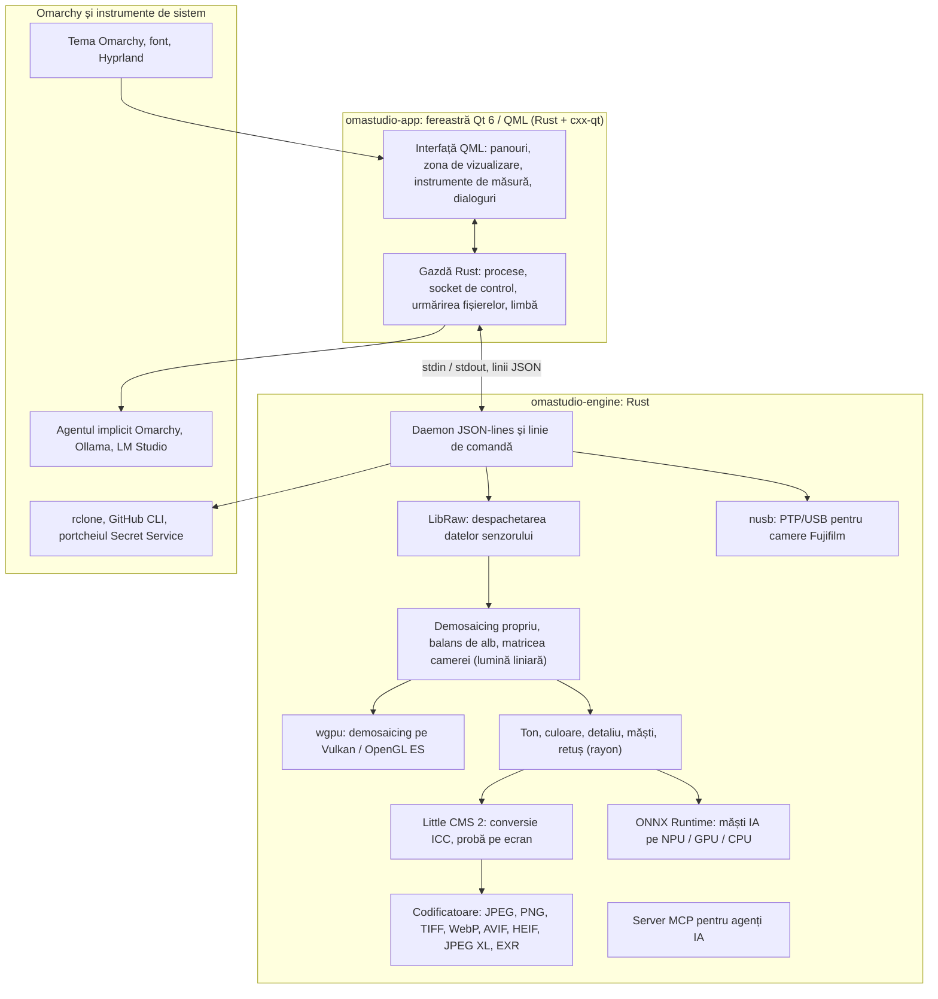

# Tehnologiile din OmaStudio

**OmaStudio: The Complete Medium Format RAW Editor for Omarchy**

[Toate limbile](../README.md) · [Ghidul utilizatorului](../guide/ro.md) · [README](../../README.md)

Această pagină descrie tehnologiile pe care este construit OmaStudio: ce face fiecare în aplicație, de ce a fost aleasă și ce licență are. OmaStudio însuși este publicat sub licența MIT.

## Arhitectură

Fereastra și motorul sunt procese separate. Fereastra nu decodează niciodată singură o fotografie: trimite comenzi motorului și afișează imaginile scrise de motor. O cădere sau un blocaj la decodare nu poate lua interfața cu el, iar același motor servește linia de comandă, scripturile și agenții IA.

## Aplicație

| Tehnologie | Rol în OmaStudio | De ce | Licență |
| :--- | :--- | :--- | :--- |
| **Rust** (1.99, ediția 2024) | Limbajul motorului și al gazdei aplicației | Siguranța memoriei pentru cod care analizează fișiere nesigure, viteză nativă și un singur limbaj pentru ambele procese | MIT / Apache-2.0 |
| **Qt 6** (6.12, Qt Quick / QML) | Interfața: panourile, zona de vizualizare, instrumentele de măsură, dialogurile | Interfață desenată pe GPU, cu suport nativ Wayland și scalare fracționară, aranjare de la dreapta la stânga și sistemul de traducere Qt Linguist | LGPL-3.0 |
| **cxx-qt** (0.10) | Leagă Rust și Qt: tipurile gazdă `Process`, `Host` și socketul de control sunt obiecte Rust folosite din QML | Legături sigure în ambele direcții, fără C++ scris de mână | MIT / Apache-2.0 |
| **Qt Wayland** | Rulează fereastra ca client Wayland nativ (app id `omastudio`) | Omarchy rulează Hyprland pe Wayland; regulile de fereastră Hyprland pot ținti app id-ul | LGPL-3.0 |
| **zenity** | Dialoguri de fișiere și dosare | Mic și disponibil în orice instalare Omarchy | LGPL-2.1+ |

Fișierele QML sunt compilate în binar ca resurse Qt, așa că o versiune instalată nu se amestecă niciodată cu fișiere de interfață rătăcite.

## Motorul RAW

| Tehnologie | Rol în OmaStudio | De ce | Licență |
| :--- | :--- | :--- | :--- |
| **LibRaw** (0.22) | Citește containerul RAW și despachetează datele senzorului, metadatele și previzualizările încorporate | Cel mai larg suport pentru camere disponibil ca bibliotecă, inclusiv Fujifilm GFX, Hasselblad, Phase One și Leaf | LGPL-2.1 sau CDDL-1.0 (legată dinamic) |
| **Lanț de developare propriu** | Nivelul de negru, balansul de alb, demosaicing X-Trans și Bayer, matricea de culoare a camerei, corecții de obiectiv, toate pe lumină liniară | Control asupra culorii de la senzor încoace și un traseu pe 16 biți până la export; demosaicingul alege între patru candidați direcționali pentru fiecare pixel | MIT (OmaStudio) |
| **rayon** (1.12) | Procesare paralelă pe toate nucleele CPU | Paralelism de date fără grupuri de fire scrise de mână | MIT / Apache-2.0 |
| **wgpu** (30) | Demosaicing pe GPU prin Vulkan (NVIDIA, AMD, Intel, Qualcomm Adreno) sau OpenGL ES, în benzi care se încadrează în limitele GPU-ului | Un singur traseu de cod pentru toți producătorii de GPU, scris în WGSL; rezultatul corespunde traseului CPU până la un nivel din 65535 | MIT / Apache-2.0 |
| **Little CMS 2** (prin crate-ul `lcms2`) | Profiluri ICC, conversie în spațiul de culoare al exportului, intenții de randare, proba pe ecran și avertizarea de gamă | Motorul de referință open-source pentru gestionarea culorii | MIT |
| **image-rs**, **tiff**, **exr** | Citirea și scrierea PNG, JPEG, TIFF, WebP, OpenEXR, Radiance HDR și PNM | Codecuri pur Rust cu consum de memorie limitat | MIT / Apache-2.0; exr: BSD-3-Clause |
| **libjxl**, **libavif**, **libheif**, **libwebp** | Export JPEG XL, AVIF, HEIF și WebP cu pierderi | Codificatoarele de referință pentru aceste formate | BSD-3-Clause, BSD-2-Clause, LGPL-3.0, BSD-3-Clause |
| **ExifTool** (opțional) | Transferă metadatele EXIF ale camerei în fișierele exportate | Scrie metadate în toate formatele exportate de OmaStudio | Artistic / GPL (program separat) |
| **Datele Lensfun** (opțional) | Profiluri pentru obiective de format mediu | O bază de date mare și întreținută de obiective, citită la rulare | Date CC BY-SA 3.0 |

Lanțul de culoare lucrează pe lumină liniară: expunerea este un pas EV fotografic, iar balansul de alb acționează asupra luminii ca multiplicatorii proprii ai camerei. Imaginile sunt codificate pentru afișaj o singură dată, înaintea modulelor creative de ton și culoare, și sunt convertite cu Little CMS la export.

## IA

| Tehnologie | Rol în OmaStudio | De ce | Licență |
| :--- | :--- | :--- | :--- |
| **ONNX Runtime** (prin crate-ul `ort`, încărcat la rulare) | Rulează modele de segmentare pentru măștile **Subiect (IA)** și **Cer (IA)** | Un singur mediu de execuție pentru NPU, GPU și CPU; opțional, deci OmaStudio pornește și fără el | MIT |
| **Execution providers** | OpenVINO (NPU Intel Core Ultra), QNN (NPU Snapdragon X), Vitis AI (NPU AMD Ryzen AI), CUDA, MIGraphX, WebGPU, XNNPACK | Folosește cel mai rapid accelerator din computer și revine la CPU | Licența proprie a fiecărui provider |
| **Agentul implicit Omarchy** (Claude Code sau Codex) | **Asistent de editare** și **Conversație IA** folosesc agentul ales cu `omarchy-default-agent`, cu propria autentificare | Niciun cont sau cheie suplimentară în OmaStudio | Condițiile proprii ale agentului |
| **Ollama**, **LM Studio** | Modele locale de viziune pentru asistentul de editare | Fotografiile rămân pe computer | MIT; LM Studio: proprietar |
| **Furnizori în cloud** (Anthropic, OpenAI, OpenRouter, Google Gemini) | Furnizori opționali pentru asistentul de editare, accesați cu `curl` | Cheile sunt păstrate în portchei și transmise prin stdin, niciodată într-o linie de comandă | Condițiile proprii ale furnizorului |
| **Model Context Protocol** | `omastudio mcp` permite agenților IA să inspecteze, să randeze, să exporte și să controleze fereastra | Un protocol deschis acceptat de mulți agenți | Specificație deschisă |

Răspunsul asistentului este limitat la o schemă JSON și adus în intervalul fiecărui control înainte de a fi aplicat, iar fiecare editare poate fi anulată.

## Camere

| Tehnologie | Rol în OmaStudio | De ce | Licență |
| :--- | :--- | :--- | :--- |
| **nusb** (0.2) | Acces USB pentru stratul PTP | Pur Rust, fără libusb sau gphoto2 | MIT / Apache-2.0 |
| **Protocolul PTP / Fujifilm** | Setări personalizate C1–C7, rețete scrise în cameră, conversie RAW în cameră | Documentat clean-room prin observare; fără cod al producătorului | MIT (OmaStudio) |
| **Regula udev** | Oferă utilizatorului autentificat acces la camerele Fujifilm în modul PTP | Nu este nevoie de root pentru a folosi o cameră | MIT (OmaStudio) |

## Conturi în cloud

| Tehnologie | Rol în OmaStudio | De ce | Licență |
| :--- | :--- | :--- | :--- |
| **rclone** | Google Drive, OneDrive, Dropbox, Box, pCloud și Yandex Disk: autentificare, răsfoire, descărcare, încărcare | Un singur client testat pentru multe servicii, cu OAuth în browser | MIT |
| **GitHub CLI** (`gh`) | Autentificare GitHub (device flow) și depozitul privat `OmaStudio` | Clientul propriu al GitHub; își păstrează tokenul în portchei | MIT |
| **libsecret** / Secret Service (`secret-tool`, `gnome-keyring`) | Păstrează cheia configurației rclone criptate a OmaStudio și cheile furnizorilor IA | Secretele nu sunt stocate niciodată în text clar | LGPL-2.1+ |

## Integrarea cu Omarchy

- **Temă.** Fiecare culoare provine din tema Omarchy activă (`~/.local/state/omarchy/current/theme/colors.toml`) și se schimbă imediat când se schimbă tema.
- **Font.** Interfața folosește fontul Omarchy (`omarchy-font-set`, citit prin fontconfig) și scalează textul după dimensiunea de bază a shell-ului Omarchy.
- **Hyprland.** Colțurile urmează rotunjirea Hyprland; fereastra este un client Wayland obișnuit cu app id `omastudio`.
- **Agent implicit.** OmaStudio urmărește `~/.config/omarchy/defaults/agent` în timp real.
- **Meniul de aplicații și bara.** Intrarea de desktop folosește o pictogramă monocromă cu contrast ridicat, ca aplicațiile proprii Omarchy; `Panel.qml` este un widget Quickshell opțional pentru bara Omarchy.
- **Limbă.** Interfața urmează limba sistemului (`LANGUAGE`, `LC_ALL`, `LC_MESSAGES`, `LANG`, `locale.conf`).

## Limbi

| Tehnologie | Rol în OmaStudio | Licență |
| :--- | :--- | :--- |
| **Qt Linguist** (fișiere `.ts`, `lrelease`) | 30 de limbi ale interfeței, compilate în binar; aranjare de la dreapta la stânga pentru arabă, ebraică și persană | LGPL-3.0 / GPL-3.0 (instrument de compilare) |
| **tools/i18n/check.py** | Oprește compilarea în CI când o traducere lipsește, a rămas în engleză, folosește alt alfabet sau are substituenți nepotriviți | MIT (OmaStudio) |

## Compilare, testare și publicare

| Tehnologie | Rol în OmaStudio | Licență |
| :--- | :--- | :--- |
| **Cargo** cu un toolchain fixat (`rust-toolchain.toml`) | Compilează motorul și aplicația ca un singur workspace; `Cargo.lock` este inclus în depozit | MIT / Apache-2.0 |
| **clang**, **pkgconf** | Compilator C și driver de linker pentru stratul intermediar LibRaw, descoperirea bibliotecilor | Apache-2.0 cu excepția LLVM, ISC |
| **GitHub Actions** într-un container `archlinux` | Compilare, teste, `clippy -D warnings` și verificarea traducerilor la fiecare modificare, cu aceleași pachete pe care le folosește Omarchy | — |
| **CodeQL** | Analiza statică a codului Rust și a fluxurilor de lucru | — |
| **Fluxul de publicare** | Construiește arhiva la un tag și o publică cu sume de control SHA-256 și atestări ale provenienței compilării | — |
| **PKGBUILD** | Pachet Arch cu dependențe, dependențe opționale și regula udev | — |

## Securitate

- Fiecare program extern rulează cu un mediu golit, în propriul grup de procese, cu o limită de timp și o limită de ieșire.
- Fiecare fișier citit de motor are o limită de dimensiune; catalogul, setările și fișierele însoțitoare sunt scrise atomic cu modul `0600`, iar legăturile simbolice sunt respinse acolo unde motorul deține dosarul.
- Socketul de control se află în `$XDG_RUNTIME_DIR/omastudio/` și răspunde doar proceselor aceluiași utilizator (`SO_PEERCRED`).
- Cheile API și tokenurile de cloud rămân în portchei și nu apar niciodată într-o linie de comandă.
- Interfața afișează tot textul dinamic ca text simplu.

Detaliile se găsesc în [SECURITY.md](../../SECURITY.md).

## Mărci comerciale

Fujifilm, GFX, X-Trans, Hasselblad, Phase One, Leica, Pentax, Mamiya și alte nume de camere sunt mărci comerciale ale proprietarilor lor și sunt folosite doar pentru a descrie compatibilitatea.
