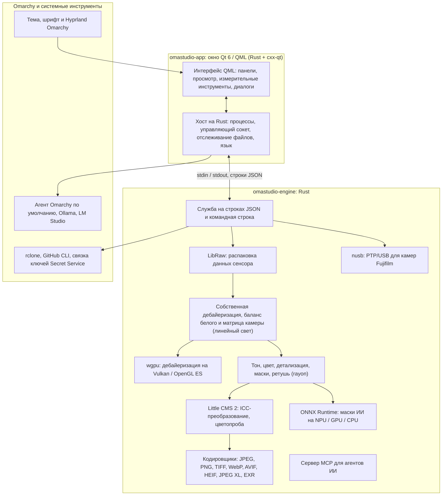

# Технологии OmaStudio

**OmaStudio: The Complete Medium Format RAW Editor for Omarchy**

[Все языки](../README.md) · [Руководство пользователя](../guide/ru.md) · [README](../../README.md)

На этой странице описаны технологии, на которых построен OmaStudio: что каждая из них делает в приложении, почему она выбрана и под какой лицензией распространяется. Сам OmaStudio выпускается под лицензией MIT.

## Архитектура

Окно и движок — отдельные процессы. Окно никогда само не декодирует фотографию: оно отправляет команды движку и показывает изображения, которые тот записывает. Сбой или зависание при декодировании не может обрушить интерфейс, а тот же движок обслуживает командную строку, скрипты и агентов ИИ.

## Приложение

| Технология | Роль в OmaStudio | Почему | Лицензия |
| :--- | :--- | :--- | :--- |
| **Rust** (1.99, редакция 2024) | Язык движка и хоста приложения | Безопасность памяти для кода, читающего недоверенные файлы, нативная скорость и один язык для обоих процессов | MIT / Apache-2.0 |
| **Qt 6** (6.12, Qt Quick / QML) | Интерфейс: панели, просмотр, измерительные инструменты, диалоги | Интерфейс, отрисовываемый на GPU, с нативной поддержкой Wayland и дробного масштабирования, раскладкой справа налево и системой перевода Qt Linguist | LGPL-3.0 |
| **cxx-qt** (0.10) | Связывает Rust и Qt: типы `Process`, `Host` и управляющий сокет — объекты Rust, используемые из QML | Безопасные привязки в обе стороны без ручного кода на C++ | MIT / Apache-2.0 |
| **Qt Wayland** | Запускает окно как нативный клиент Wayland (идентификатор приложения `omastudio`) | Omarchy использует Hyprland на Wayland; правила окон Hyprland могут опираться на идентификатор | LGPL-3.0 |
| **zenity** | Диалоги выбора файлов и папок | Небольшой и есть в каждой установке Omarchy | LGPL-2.1+ |

Файлы QML компилируются в исполняемый файл как ресурсы Qt, поэтому установленная версия никогда не смешивается с посторонними файлами интерфейса.

## RAW-движок

| Технология | Роль в OmaStudio | Почему | Лицензия |
| :--- | :--- | :--- | :--- |
| **LibRaw** (0.22) | Читает контейнер RAW и извлекает данные сенсора, метаданные и встроенные превью | Самая широкая поддержка камер среди доступных библиотек, включая Fujifilm GFX, Hasselblad, Phase One и Leaf | LGPL-2.1 или CDDL-1.0 (динамическая компоновка) |
| **Собственный конвейер проявки** | Уровень чёрного, баланс белого, дебайеризация X-Trans и Bayer, цветовая матрица камеры, коррекции объектива — всё в линейном свете | Контроль цвета начиная с сенсора и 16-битный путь до экспорта; дебайеризация для каждого пикселя выбирает из четырёх направленных кандидатов | MIT (OmaStudio) |
| **rayon** (1.12) | Параллельная обработка на всех ядрах CPU | Параллелизм данных без самописных пулов потоков | MIT / Apache-2.0 |
| **wgpu** (30) | Дебайеризация на GPU через Vulkan (NVIDIA, AMD, Intel, Qualcomm Adreno) или OpenGL ES полосами, которые укладываются в ограничения GPU | Один путь кода для всех производителей GPU, написанный на WGSL; результат совпадает с путём на CPU с точностью до одного уровня из 65535 | MIT / Apache-2.0 |
| **Little CMS 2** (через crate `lcms2`) | ICC-профили, преобразование в цветовое пространство экспорта, методы рендеринга, цветопроба и предупреждение об охвате | Эталонный движок управления цветом с открытым исходным кодом | MIT |
| **image-rs**, **tiff**, **exr** | Чтение и запись PNG, JPEG, TIFF, WebP, OpenEXR, Radiance HDR и PNM | Кодеки на чистом Rust с ограниченным расходом памяти | MIT / Apache-2.0; exr: BSD-3-Clause |
| **libjxl**, **libavif**, **libheif**, **libwebp** | Экспорт в JPEG XL, AVIF, HEIF и WebP с потерями | Эталонные кодировщики этих форматов | BSD-3-Clause, BSD-2-Clause, LGPL-3.0, BSD-3-Clause |
| **ExifTool** (необязательно) | Переносит метаданные EXIF камеры в экспортированные файлы | Записывает метаданные во все форматы, которые экспортирует OmaStudio | Artistic / GPL (отдельная программа) |
| **Данные Lensfun** (необязательно) | Профили объективов среднего формата | Большая поддерживаемая база объективов, читаемая во время работы | Данные CC BY-SA 3.0 |

Цветовой конвейер работает в линейном свете: экспозиция — это фотографический шаг EV, а баланс белого действует на свет так же, как множители самой камеры. Изображение кодируется для экрана один раз, перед творческими модулями тона и цвета, и преобразуется с помощью Little CMS при экспорте.

## ИИ

| Технология | Роль в OmaStudio | Почему | Лицензия |
| :--- | :--- | :--- | :--- |
| **ONNX Runtime** (через crate `ort`, загружается во время работы) | Запускает модели сегментации для масок **Объект (ИИ)** и **Небо (ИИ)** | Одна среда выполнения для NPU, GPU и CPU; необязательна, OmaStudio запускается и без неё | MIT |
| **Провайдеры выполнения** | OpenVINO (NPU Intel Core Ultra), QNN (NPU Snapdragon X), Vitis AI (NPU AMD Ryzen AI), CUDA, MIGraphX, WebGPU, XNNPACK | Используется самый быстрый ускоритель компьютера, с откатом на CPU | Лицензия каждого провайдера |
| **Агент Omarchy по умолчанию** (Claude Code или Codex) | Ассистент редактирования и чат с ИИ используют агента, выбранного через `omarchy-default-agent`, с его собственным входом | Никаких дополнительных аккаунтов и ключей в OmaStudio | Условия агента |
| **Ollama**, **LM Studio** | Локальные модели компьютерного зрения для ассистента редактирования | Фотографии остаются на компьютере | MIT; LM Studio: проприетарная |
| **Облачные провайдеры** (Anthropic, OpenAI, OpenRouter, Google Gemini) | Необязательные провайдеры для ассистента редактирования, доступные через `curl` | Ключи хранятся в связке ключей и передаются через stdin, никогда — в командной строке | Условия провайдера |
| **Model Context Protocol** | `omastudio mcp` позволяет агентам ИИ анализировать, обрабатывать, экспортировать фотографии и управлять окном | Открытый протокол, который поддерживают многие агенты | Открытая спецификация |

Ответ ассистента ограничен схемой JSON и перед применением приводится к диапазону каждого регулятора; любую правку можно отменить.

## Камеры

| Технология | Роль в OmaStudio | Почему | Лицензия |
| :--- | :--- | :--- | :--- |
| **nusb** (0.2) | Доступ к USB для уровня PTP | Чистый Rust, без libusb и gphoto2 | MIT / Apache-2.0 |
| **PTP / протокол Fujifilm** | Пользовательские настройки C1–C7, запись рецептов в камеру, конвертация RAW в камере | Задокументирован методом «чистой комнаты» по наблюдениям; без кода производителя | MIT (OmaStudio) |
| **Правило udev** | Даёт вошедшему в систему пользователю доступ к камерам Fujifilm в режиме PTP | Для работы с камерой не нужен root | MIT (OmaStudio) |

## Облачные аккаунты

| Технология | Роль в OmaStudio | Почему | Лицензия |
| :--- | :--- | :--- | :--- |
| **rclone** | Google Drive, OneDrive, Dropbox, Box, pCloud и Яндекс Диск: вход, просмотр, скачивание, загрузка | Один проверенный клиент для многих сервисов, с OAuth в браузере | MIT |
| **GitHub CLI** (`gh`) | Вход в GitHub (device flow) и приватный репозиторий `OmaStudio` | Собственный клиент GitHub; хранит свой токен в связке ключей | MIT |
| **libsecret** / Secret Service (`secret-tool`, `gnome-keyring`) | Хранит ключ зашифрованной конфигурации rclone OmaStudio и ключи провайдеров ИИ | Секреты никогда не хранятся открытым текстом | LGPL-2.1+ |

## Интеграция с Omarchy

- **Тема.** Каждый цвет берётся из активной темы Omarchy (`~/.local/state/omarchy/current/theme/colors.toml`) и меняется сразу при смене темы.
- **Шрифт.** Интерфейс использует шрифт Omarchy (`omarchy-font-set`, читается через fontconfig) и масштабирует текст по базовому размеру оболочки Omarchy.
- **Hyprland.** Углы следуют скруглению Hyprland; окно — обычный клиент Wayland с идентификатором `omastudio`.
- **Агент по умолчанию.** OmaStudio отслеживает `~/.config/omarchy/defaults/agent` на лету.
- **Меню приложений и панель.** Ярлык приложения использует контрастный монохромный значок, как собственные приложения Omarchy; `Panel.qml` — необязательный виджет Quickshell для панели Omarchy.
- **Язык.** Интерфейс следует языку системы (`LANGUAGE`, `LC_ALL`, `LC_MESSAGES`, `LANG`, `locale.conf`).

## Языки

| Технология | Роль в OmaStudio | Лицензия |
| :--- | :--- | :--- |
| **Qt Linguist** (файлы `.ts`, `lrelease`) | 30 языков интерфейса, скомпилированных в исполняемый файл; раскладка справа налево для арабского, иврита и персидского | LGPL-3.0 / GPL-3.0 (инструмент сборки) |
| **tools/i18n/check.py** | Останавливает сборку в CI, если перевод отсутствует, остался на английском, написан не тем письмом или его заполнители не совпадают | MIT (OmaStudio) |

## Сборка, тесты и выпуск

| Технология | Роль в OmaStudio | Лицензия |
| :--- | :--- | :--- |
| **Cargo** с закреплённым инструментарием (`rust-toolchain.toml`) | Собирает движок и приложение как одно рабочее пространство; `Cargo.lock` хранится в репозитории | MIT / Apache-2.0 |
| **clang**, **pkgconf** | Компилятор C и драйвер компоновщика для прослойки LibRaw, поиск библиотек | Apache-2.0 с исключением LLVM, ISC |
| **GitHub Actions** в контейнере `archlinux` | Сборка, тесты, `clippy -D warnings` и проверка переводов при каждом изменении, с теми же пакетами, что и в Omarchy | — |
| **CodeQL** | Статический анализ кода на Rust и рабочих процессов | — |
| **Процесс выпуска** | Собирает архив по тегу и публикует его с контрольными суммами SHA-256 и аттестациями происхождения сборки | — |
| **PKGBUILD** | Пакет Arch с зависимостями, необязательными зависимостями и правилом udev | — |

## Безопасность

- Каждая внешняя программа запускается с очищенным окружением, в собственной группе процессов, с ограничением по времени и объёму вывода.
- Для каждого файла, который читает движок, задан предельный размер; каталог, настройки и файлы правок записываются атомарно с режимом `0600`, а символические ссылки отклоняются там, где папка принадлежит движку.
- Управляющий сокет находится в `$XDG_RUNTIME_DIR/omastudio/` и отвечает только процессам того же пользователя (`SO_PEERCRED`).
- API-ключи и облачные токены остаются в связке ключей и никогда не появляются в командной строке.
- Интерфейс показывает весь динамический текст как простой текст.

Подробности — в [SECURITY.md](../../SECURITY.md).

## Товарные знаки

Fujifilm, GFX, X-Trans, Hasselblad, Phase One, Leica, Pentax, Mamiya и другие названия камер являются товарными знаками их владельцев и используются только для указания совместимости.
