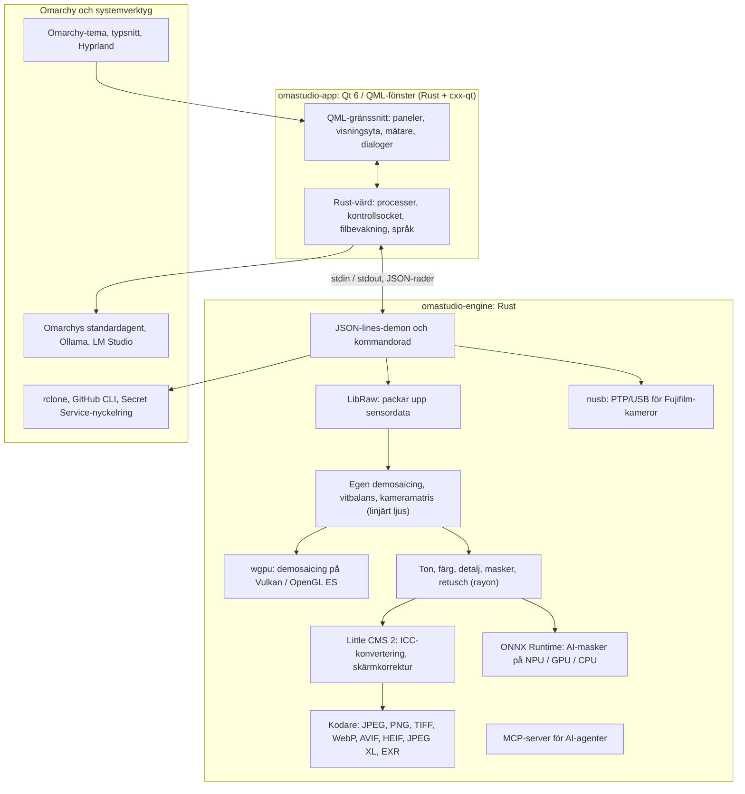

# Tekniker i OmaStudio

**OmaStudio: The Complete Medium Format RAW Editor for Omarchy**

[Alla språk](../README.md) · [Användarhandbok](../guide/sv.md) · [README](../../README.md)

Den här sidan beskriver teknikerna som OmaStudio bygger på: vad var och en gör i programmet, varför den valdes och vilken licens den har. OmaStudio självt släpps under MIT-licensen.

## Arkitektur

Fönstret och motorn är separata processer. Fönstret avkodar aldrig ett foto självt: det skickar kommandon till motorn och visar bilderna som motorn skriver. En krasch eller ett häng i avkodningen kan inte ta med sig gränssnittet, och samma motor betjänar kommandoraden, skript och AI-agenter.

## Program

| Teknik | Roll i OmaStudio | Varför | Licens |
| :--- | :--- | :--- | :--- |
| **Rust** (1.99, edition 2024) | Språket för motorn och programvärden | Minnessäkerhet för kod som tolkar opålitliga filer, inbyggd hastighet och ett språk för båda processerna | MIT / Apache-2.0 |
| **Qt 6** (6.12, Qt Quick / QML) | Gränssnittet: paneler, visningsytan, mätare, dialoger | GPU-ritat gränssnitt med inbyggt Wayland-stöd och fraktionell skalning, höger-till-vänster-layout och översättningssystemet Qt Linguist | LGPL-3.0 |
| **cxx-qt** (0.10) | Kopplar ihop Rust och Qt: värdtyperna `Process`, `Host` och kontrollsocketen är Rust-objekt som används från QML | Säkra bindningar åt båda hållen utan handskriven C++ | MIT / Apache-2.0 |
| **Qt Wayland** | Kör fönstret som en inbyggd Wayland-klient (app-id `omastudio`) | Omarchy kör Hyprland på Wayland; Hyprlands fönsterregler kan matcha app-id:t | LGPL-3.0 |
| **zenity** | Fil- och mappdialoger | Litet och finns i varje Omarchy-installation | LGPL-2.1+ |

QML-filerna kompileras in i binären som Qt-resurser, så en installerad version blandas aldrig med lösa gränssnittsfiler.

## RAW-motor

| Teknik | Roll i OmaStudio | Varför | Licens |
| :--- | :--- | :--- | :--- |
| **LibRaw** (0.22) | Läser RAW-behållaren och packar upp sensordata, metadata och inbäddade förhandsvisningar | Det bredaste kamerastödet som finns som bibliotek, inklusive Fujifilm GFX, Hasselblad, Phase One och Leaf | LGPL-2.1 eller CDDL-1.0 (dynamiskt länkat) |
| **Egen framkallningskedja** | Svartnivå, vitbalans, X-Trans- och Bayer-demosaicing, kamerans färgmatris, objektivkorrigeringar, allt i linjärt ljus | Kontroll över färgen från sensorn och framåt och en 16-bitarsväg till exporten; demosaicingen väljer mellan fyra riktningskandidater per pixel | MIT (OmaStudio) |
| **rayon** (1.12) | Parallell bearbetning på alla CPU-kärnor | Dataparallellism utan handskrivna trådpooler | MIT / Apache-2.0 |
| **wgpu** (30) | Demosaicing på GPU:n via Vulkan (NVIDIA, AMD, Intel, Qualcomm Adreno) eller OpenGL ES, i band som ryms inom GPU:ns gränser | En kodväg för alla GPU-tillverkare, skriven i WGSL; resultatet stämmer med CPU-vägen inom en nivå av 65535 | MIT / Apache-2.0 |
| **Little CMS 2** (via craten `lcms2`) | ICC-profiler, konvertering till exportens färgrymd, återgivningsavsikter, skärmkorrektur och färgomfångsvarningen | Referensmotorn för färghantering med öppen källkod | MIT |
| **image-rs**, **tiff**, **exr** | Läser och skriver PNG, JPEG, TIFF, WebP, OpenEXR, Radiance HDR och PNM | Kodekar i ren Rust med begränsad minnesanvändning | MIT / Apache-2.0; exr: BSD-3-Clause |
| **libjxl**, **libavif**, **libheif**, **libwebp** | Export till JPEG XL, AVIF, HEIF och förstörande WebP | Referenskodarna för dessa format | BSD-3-Clause, BSD-2-Clause, LGPL-3.0, BSD-3-Clause |
| **ExifTool** (valfritt) | För över kamerans EXIF-metadata till exporterade filer | Skriver metadata till alla format som OmaStudio exporterar | Artistic / GPL (separat program) |
| **Lensfun-data** (valfritt) | Objektivprofiler för mellanformatsobjektiv | En stor, underhållen objektivdatabas som läses vid körning | Data CC BY-SA 3.0 |

Färgkedjan arbetar i linjärt ljus: exponering är ett fotografiskt EV-steg och vitbalans verkar på ljuset som kamerans egna multiplikatorer gör. Bilderna kodas för skärm en gång, före de kreativa ton- och färgmodulerna, och konverteras med Little CMS vid export.

## AI

| Teknik | Roll i OmaStudio | Varför | Licens |
| :--- | :--- | :--- | :--- |
| **ONNX Runtime** (via craten `ort`, laddas vid körning) | Kör segmenteringsmodeller för maskerna **AI-motiv** och **AI-himmel** | En körmiljö för NPU:er, GPU:er och CPU:er; valfri, så OmaStudio startar utan den | MIT |
| **Execution providers** | OpenVINO (Intel Core Ultra NPU), QNN (Snapdragon X NPU), Vitis AI (AMD Ryzen AI NPU), CUDA, MIGraphX, WebGPU, XNNPACK | Använder datorns snabbaste accelerator och faller tillbaka på CPU:n | Varje providers egen licens |
| **Omarchys standardagent** (Claude Code eller Codex) | **Redigeringsassistent** och **AI-samtal** använder agenten som valts med `omarchy-default-agent`, med dess egen inloggning | Inget extra konto eller nyckel i OmaStudio | Agentens egna villkor |
| **Ollama**, **LM Studio** | Lokala bildmodeller för redigeringsassistenten | Fotona stannar på datorn | MIT; LM Studio: proprietär |
| **Molnleverantörer** (Anthropic, OpenAI, OpenRouter, Google Gemini) | Valfria leverantörer för redigeringsassistenten, nås med `curl` | Nycklarna lagras i nyckelringen och skickas via stdin, aldrig på en kommandorad | Leverantörens egna villkor |
| **Model Context Protocol** | `omastudio mcp` låter AI-agenter granska, rendera, exportera och styra fönstret | Ett öppet protokoll som stöds av många agenter | Öppen specifikation |

Assistentens svar begränsas till ett JSON-schema och kläms till varje reglages intervall innan det tillämpas, och varje ändring kan ångras.

## Kameror

| Teknik | Roll i OmaStudio | Varför | Licens |
| :--- | :--- | :--- | :--- |
| **nusb** (0.2) | USB-åtkomst för PTP-lagret | Ren Rust, varken libusb eller gphoto2 behövs | MIT / Apache-2.0 |
| **PTP / Fujifilm-protokoll** | Egna inställningar C1–C7, recept som skrivs till kameran, RAW-konvertering i kameran | Dokumenterat i clean room utifrån observation; ingen tillverkarkod | MIT (OmaStudio) |
| **udev-regel** | Ger den inloggade användaren åtkomst till Fujifilm-kameror i PTP-läge | Ingen root behövs för att använda en kamera | MIT (OmaStudio) |

## Molnkonton

| Teknik | Roll i OmaStudio | Varför | Licens |
| :--- | :--- | :--- | :--- |
| **rclone** | Google Drive, OneDrive, Dropbox, Box, pCloud och Yandex Disk: inloggning, bläddring, nedladdning, uppladdning | En beprövad klient för många tjänster, med OAuth i webbläsaren | MIT |
| **GitHub CLI** (`gh`) | GitHub-inloggning (device flow) och det privata förrådet `OmaStudio` | GitHubs egen klient; håller sin token i nyckelringen | MIT |
| **libsecret** / Secret Service (`secret-tool`, `gnome-keyring`) | Förvarar nyckeln till OmaStudios krypterade rclone-konfiguration och AI-leverantörernas nycklar | Hemligheter lagras aldrig i klartext | LGPL-2.1+ |

## Integration med Omarchy

- **Tema.** Varje färg kommer från det aktiva Omarchy-temat (`~/.local/state/omarchy/current/theme/colors.toml`) och ändras direkt när temat byts.
- **Typsnitt.** Gränssnittet använder Omarchys typsnitt (`omarchy-font-set`, läst via fontconfig) och skalar texten utifrån Omarchy-skalets grundstorlek.
- **Hyprland.** Hörnen följer Hyprlands rundning; fönstret är en vanlig Wayland-klient med app-id `omastudio`.
- **Standardagent.** OmaStudio följer `~/.config/omarchy/defaults/agent` direkt.
- **Programmeny och panel.** Skrivbordsposten använder en monokrom ikon med hög kontrast som Omarchys egna program; `Panel.qml` är en valfri Quickshell-widget för Omarchys panel.
- **Språk.** Gränssnittet följer systemspråket (`LANGUAGE`, `LC_ALL`, `LC_MESSAGES`, `LANG`, `locale.conf`).

## Språk

| Teknik | Roll i OmaStudio | Licens |
| :--- | :--- | :--- |
| **Qt Linguist** (`.ts`-filer, `lrelease`) | 30 gränssnittsspråk, inkompilerade i binären; höger-till-vänster-layout för arabiska, hebreiska och persiska | LGPL-3.0 / GPL-3.0 (byggverktyg) |
| **tools/i18n/check.py** | Får bygget i CI att misslyckas när en översättning saknas, står kvar på engelska, har fel skriftsystem eller felaktiga platshållare | MIT (OmaStudio) |

## Bygge, test och release

| Teknik | Roll i OmaStudio | Licens |
| :--- | :--- | :--- |
| **Cargo** med låst verktygskedja (`rust-toolchain.toml`) | Bygger motorn och programmet som en arbetsyta; `Cargo.lock` är incheckad | MIT / Apache-2.0 |
| **clang**, **pkgconf** | C-kompilator och länkardrivrutin för LibRaw-mellanlagret, hittar bibliotek | Apache-2.0 med LLVM-undantag, ISC |
| **GitHub Actions** i en `archlinux`-behållare | Bygge, tester, `clippy -D warnings` och översättningskontrollen vid varje ändring, med samma paket som Omarchy använder | — |
| **CodeQL** | Statisk analys av Rust-koden och arbetsflödena | — |
| **Release-arbetsflöde** | Bygger arkivet vid en tagg och publicerar det med SHA-256-kontrollsummor och attesteringar av byggets ursprung | — |
| **PKGBUILD** | Arch-paket med beroenden, valfria beroenden och udev-regeln | — |

## Säkerhet

- Varje externt program körs med rensad miljö, egen processgrupp, en tidsgräns och en gräns för utdata.
- Varje fil som motorn läser har en storleksgräns; katalog, inställningar och sidofiler skrivs atomärt med läget `0600`, och symboliska länkar avvisas där motorn äger mappen.
- Kontrollsocketen ligger i `$XDG_RUNTIME_DIR/omastudio/` och svarar bara processer från samma användare (`SO_PEERCRED`).
- API-nycklar och molntokens stannar i nyckelringen och syns aldrig på en kommandorad.
- Gränssnittet visar all dynamisk text som vanlig text.

Detaljer finns i [SECURITY.md](../../SECURITY.md).

## Varumärken

Fujifilm, GFX, X-Trans, Hasselblad, Phase One, Leica, Pentax, Mamiya och andra kameranamn är varumärken som tillhör sina ägare och används endast för att beskriva kompatibilitet.
