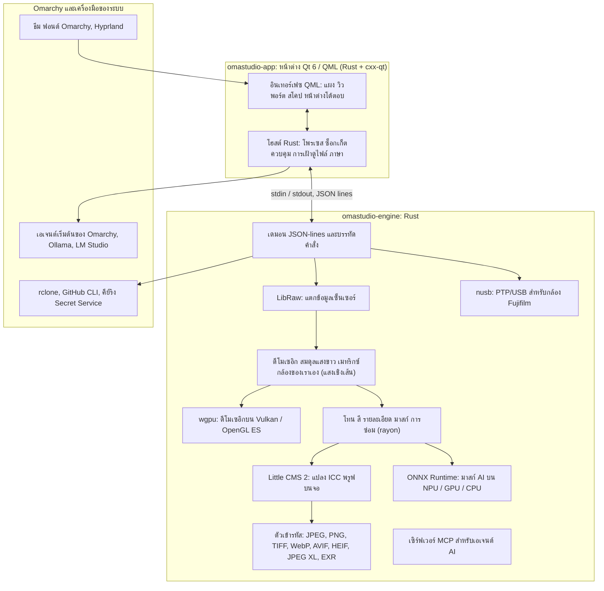

# เทคโนโลยีใน OmaStudio

**OmaStudio: The Complete Medium Format RAW Editor for Omarchy**

[ทุกภาษา](../README.md) · [คู่มือการใช้งาน](../guide/th.md) · [README](../../README.md)

หน้านี้อธิบายเทคโนโลยีที่ OmaStudio สร้างขึ้นจาก หน้าที่ของแต่ละตัวในแอปพลิเคชัน เหตุผลที่เลือก และสัญญาอนุญาต ตัว OmaStudio เองเผยแพร่ภายใต้สัญญาอนุญาต MIT

## สถาปัตยกรรม

หน้าต่างและเอนจินเป็นโพรเซสแยกกัน หน้าต่างไม่ถอดรหัสภาพเอง แต่ส่งคำสั่งไปยังเอนจินและแสดงภาพที่เอนจินเขียนออกมา การแครชหรือค้างระหว่างถอดรหัสจึงไม่ทำให้อินเทอร์เฟซล่มตามไปด้วย และเอนจินตัวเดียวกันนี้ให้บริการบรรทัดคำสั่ง สคริปต์ และเอเจนต์ AI

## แอปพลิเคชัน

| เทคโนโลยี | หน้าที่ใน OmaStudio | เหตุผล | สัญญาอนุญาต |
| :--- | :--- | :--- | :--- |
| **Rust** (1.99, edition 2024) | ภาษาของเอนจินและโฮสต์ของแอปพลิเคชัน | ความปลอดภัยของหน่วยความจำสำหรับโค้ดที่แยกวิเคราะห์ไฟล์ที่ไม่น่าเชื่อถือ ความเร็วแบบเนทีฟ และใช้ภาษาเดียวกันทั้งสองโพรเซส | MIT / Apache-2.0 |
| **Qt 6** (6.12, Qt Quick / QML) | อินเทอร์เฟซ: แผง วิวพอร์ต สโคป หน้าต่างโต้ตอบ | อินเทอร์เฟซที่วาดด้วย GPU รองรับ Wayland แบบเนทีฟและสเกลเศษส่วน การจัดวางจากขวาไปซ้าย และระบบแปลภาษา Qt Linguist | LGPL-3.0 |
| **cxx-qt** (0.10) | เชื่อม Rust กับ Qt: ชนิดของโฮสต์ `Process`, `Host` และซ็อกเก็ตควบคุมเป็นออบเจกต์ Rust ที่ใช้จาก QML | การผูกที่ปลอดภัยทั้งสองทิศทางโดยไม่ต้องเขียน C++ เอง | MIT / Apache-2.0 |
| **Qt Wayland** | รันหน้าต่างเป็นไคลเอนต์ Wayland แบบเนทีฟ (app id `omastudio`) | Omarchy รัน Hyprland บน Wayland กฎหน้าต่างของ Hyprland จับคู่กับ app id ได้ | LGPL-3.0 |
| **zenity** | หน้าต่างเลือกไฟล์และโฟลเดอร์ | เล็ก และมีในการติดตั้ง Omarchy ทุกเครื่อง | LGPL-2.1+ |

ไฟล์ QML ถูกคอมไพล์เข้าไปในไบนารีเป็นรีซอร์สของ Qt เวอร์ชันที่ติดตั้งจึงไม่ปะปนกับไฟล์อินเทอร์เฟซที่หลงเหลืออยู่

## เอนจิน RAW

| เทคโนโลยี | หน้าที่ใน OmaStudio | เหตุผล | สัญญาอนุญาต |
| :--- | :--- | :--- | :--- |
| **LibRaw** (0.22) | อ่านคอนเทนเนอร์ RAW และแตกข้อมูลเซ็นเซอร์ ข้อมูลเมตา และภาพตัวอย่างที่ฝังไว้ | รองรับกล้องกว้างที่สุดในรูปแบบไลบรารี รวมถึง Fujifilm GFX, Hasselblad, Phase One และ Leaf | LGPL-2.1 หรือ CDDL-1.0 (ลิงก์แบบไดนามิก) |
| **ไปป์ไลน์การพัฒนาภาพของเราเอง** | ระดับดำ สมดุลแสงขาว ดีโมเซอิก X-Trans และ Bayer เมทริกซ์สีของกล้อง การแก้ไขเลนส์ ทั้งหมดบนแสงเชิงเส้น | ควบคุมสีได้ตั้งแต่เซ็นเซอร์ และมีเส้นทาง 16 บิตจนถึงการส่งออก ดีโมเซอิกเลือกจากผู้สมัครตามทิศทางสี่แบบในแต่ละพิกเซล | MIT (OmaStudio) |
| **rayon** (1.12) | ประมวลผลขนานบนทุกคอร์ของ CPU | ขนานข้อมูลโดยไม่ต้องเขียนเธรดพูลเอง | MIT / Apache-2.0 |
| **wgpu** (30) | ดีโมเซอิกบน GPU ผ่าน Vulkan (NVIDIA, AMD, Intel, Qualcomm Adreno) หรือ OpenGL ES เป็นแถบที่พอดีกับขีดจำกัดของ GPU | เส้นทางโค้ดเดียวสำหรับ GPU ทุกผู้ผลิต เขียนด้วย WGSL ผลลัพธ์ตรงกับเส้นทาง CPU ภายในหนึ่งระดับจาก 65535 | MIT / Apache-2.0 |
| **Little CMS 2** (ผ่าน crate `lcms2`) | โปรไฟล์ ICC การแปลงเป็นพื้นที่สีส่งออก วิธีการเรนเดอร์ พรูฟบนจอ และการเตือนขอบเขตสี | เอนจินจัดการสีโอเพนซอร์สที่เป็นมาตรฐานอ้างอิง | MIT |
| **image-rs**, **tiff**, **exr** | อ่านและเขียน PNG, JPEG, TIFF, WebP, OpenEXR, Radiance HDR และ PNM | โคเดก Rust ล้วนที่ใช้หน่วยความจำอย่างจำกัด | MIT / Apache-2.0; exr: BSD-3-Clause |
| **libjxl**, **libavif**, **libheif**, **libwebp** | ส่งออก JPEG XL, AVIF, HEIF และ WebP แบบสูญเสียข้อมูล | ตัวเข้ารหัสอ้างอิงของรูปแบบเหล่านี้ | BSD-3-Clause, BSD-2-Clause, LGPL-3.0, BSD-3-Clause |
| **ExifTool** (เสริม) | นำข้อมูลเมตา EXIF ของกล้องไปไว้ในไฟล์ที่ส่งออก | เขียนข้อมูลเมตาลงได้ทุกรูปแบบที่ OmaStudio ส่งออก | Artistic / GPL (โปรแกรมแยก) |
| **ข้อมูล Lensfun** (เสริม) | โปรไฟล์เลนส์สำหรับเลนส์มีเดียมฟอร์แมต | ฐานข้อมูลเลนส์ขนาดใหญ่ที่มีการดูแล อ่านขณะรัน | ข้อมูล CC BY-SA 3.0 |

ไปป์ไลน์สีทำงานบนแสงเชิงเส้น: การเปิดรับแสงเป็นขั้น EV แบบการถ่ายภาพ และสมดุลแสงขาวทำงานกับแสงแบบเดียวกับตัวคูณของกล้อง ภาพถูกเข้ารหัสสำหรับจอแสดงผลครั้งเดียวก่อนโมดูลโทนและสีเชิงสร้างสรรค์ และแปลงด้วย Little CMS ตอนส่งออก

## ปัญญาประดิษฐ์

| เทคโนโลยี | หน้าที่ใน OmaStudio | เหตุผล | สัญญาอนุญาต |
| :--- | :--- | :--- | :--- |
| **ONNX Runtime** (ผ่าน crate `ort` โหลดขณะรัน) | รันโมเดลแบ่งส่วนภาพสำหรับมาสก์ **วัตถุหลัก (AI)** และ **ท้องฟ้า (AI)** | รันไทม์เดียวสำหรับ NPU, GPU และ CPU เป็นตัวเสริม OmaStudio จึงเริ่มทำงานได้โดยไม่ต้องมี | MIT |
| **Execution provider** | OpenVINO (NPU ของ Intel Core Ultra), QNN (NPU ของ Snapdragon X), Vitis AI (NPU ของ AMD Ryzen AI), CUDA, MIGraphX, WebGPU, XNNPACK | ใช้ตัวเร่งที่เร็วที่สุดในคอมพิวเตอร์ และถอยกลับไปใช้ CPU | สัญญาอนุญาตของแต่ละ provider |
| **เอเจนต์เริ่มต้นของ Omarchy** (Claude Code หรือ Codex) | ผู้ช่วยแก้ไขและแชตกับ AI ใช้เอเจนต์ที่เลือกด้วย `omarchy-default-agent` พร้อมการลงชื่อเข้าใช้ของตัวเอง | ไม่ต้องมีบัญชีหรือคีย์เพิ่มใน OmaStudio | ข้อกำหนดของเอเจนต์นั้น |
| **Ollama**, **LM Studio** | โมเดลวิชันภายในเครื่องสำหรับผู้ช่วยแก้ไข | ภาพอยู่บนคอมพิวเตอร์ | MIT; LM Studio: กรรมสิทธิ์ |
| **ผู้ให้บริการคลาวด์** (Anthropic, OpenAI, OpenRouter, Google Gemini) | ผู้ให้บริการเสริมสำหรับผู้ช่วยแก้ไข เข้าถึงด้วย `curl` | คีย์เก็บในคีย์ริงและส่งผ่าน stdin ไม่อยู่บนบรรทัดคำสั่ง | ข้อกำหนดของผู้ให้บริการ |
| **Model Context Protocol** | `omastudio mcp` ให้เอเจนต์ AI ตรวจดู เรนเดอร์ ส่งออก และควบคุมหน้าต่าง | โพรโทคอลเปิดที่เอเจนต์จำนวนมากรองรับ | ข้อกำหนดเปิด |

คำตอบของผู้ช่วยถูกจำกัดด้วย JSON schema และถูกจำกัดให้อยู่ในช่วงของแต่ละตัวควบคุมก่อนนำไปใช้ และการแก้ไขแต่ละครั้งเลิกทำได้

## กล้อง

| เทคโนโลยี | หน้าที่ใน OmaStudio | เหตุผล | สัญญาอนุญาต |
| :--- | :--- | :--- | :--- |
| **nusb** (0.2) | การเข้าถึง USB สำหรับชั้น PTP | Rust ล้วน ไม่ต้องใช้ libusb หรือ gphoto2 | MIT / Apache-2.0 |
| **โพรโทคอล PTP / Fujifilm** | ค่าที่กำหนดเอง C1–C7 สูตรที่เขียนลงกล้อง การแปลง RAW ในกล้อง | จัดทำเอกสารแบบ clean-room จากการสังเกต ไม่มีโค้ดของผู้ผลิต | MIT (OmaStudio) |
| **กฎ udev** | ให้ผู้ใช้ที่ลงชื่อเข้าใช้เข้าถึงกล้อง Fujifilm ในโหมด PTP | ไม่ต้องใช้ root เพื่อใช้กล้อง | MIT (OmaStudio) |

## บัญชีคลาวด์

| เทคโนโลยี | หน้าที่ใน OmaStudio | เหตุผล | สัญญาอนุญาต |
| :--- | :--- | :--- | :--- |
| **rclone** | Google Drive, OneDrive, Dropbox, Box, pCloud และ Yandex Disk: ลงชื่อเข้าใช้ เรียกดู ดาวน์โหลด อัปโหลด | ไคลเอนต์ที่ผ่านการทดสอบตัวเดียวสำหรับหลายบริการ พร้อม OAuth ในเบราว์เซอร์ | MIT |
| **GitHub CLI** (`gh`) | การลงชื่อเข้าใช้ GitHub (device flow) และรีโพซิทอรีส่วนตัว `OmaStudio` | ไคลเอนต์ของ GitHub เอง เก็บโทเคนไว้ในคีย์ริง | MIT |
| **libsecret** / Secret Service (`secret-tool`, `gnome-keyring`) | เก็บคีย์ของการตั้งค่า rclone ที่เข้ารหัสของ OmaStudio และคีย์ของผู้ให้บริการ AI | ความลับไม่ถูกเก็บเป็นข้อความธรรมดา | LGPL-2.1+ |

## การผสานกับ Omarchy

- **ธีม** ทุกสีมาจากธีม Omarchy ที่ใช้อยู่ (`~/.local/state/omarchy/current/theme/colors.toml`) และเปลี่ยนแบบสดเมื่อเปลี่ยนธีม
- **ฟอนต์** อินเทอร์เฟซใช้ฟอนต์ของ Omarchy (`omarchy-font-set` อ่านผ่าน fontconfig) และปรับขนาดข้อความจากขนาดพื้นฐานของเชลล์ Omarchy
- **Hyprland** มุมเป็นไปตามความมนของ Hyprland หน้าต่างเป็นไคลเอนต์ Wayland ปกติที่มี app id `omastudio`
- **เอเจนต์เริ่มต้น** OmaStudio ตาม `~/.config/omarchy/defaults/agent` แบบสด
- **เมนูแอปและแถบ** รายการเดสก์ท็อปใช้ไอคอนขาวดำคอนทราสต์สูงแบบเดียวกับแอปของ Omarchy เอง `Panel.qml` เป็นวิดเจ็ต Quickshell เสริมสำหรับแถบของ Omarchy
- **ภาษา** อินเทอร์เฟซตามภาษาของระบบ (`LANGUAGE`, `LC_ALL`, `LC_MESSAGES`, `LANG`, `locale.conf`)

## ภาษา

| เทคโนโลยี | หน้าที่ใน OmaStudio | สัญญาอนุญาต |
| :--- | :--- | :--- |
| **Qt Linguist** (ไฟล์ `.ts`, `lrelease`) | อินเทอร์เฟซ 30 ภาษา คอมไพล์เข้าไปในไบนารี การจัดวางจากขวาไปซ้ายสำหรับภาษาอาหรับ ฮีบรู และเปอร์เซีย | LGPL-3.0 / GPL-3.0 (เครื่องมือบิลด์) |
| **tools/i18n/check.py** | ทำให้การบิลด์ใน CI ล้มเหลวเมื่อคำแปลขาดหาย ยังเป็นภาษาอังกฤษ ใช้อักษรผิด หรือตัวยึดตำแหน่งไม่ตรงกัน | MIT (OmaStudio) |

## การบิลด์ การทดสอบ และการเผยแพร่

| เทคโนโลยี | หน้าที่ใน OmaStudio | สัญญาอนุญาต |
| :--- | :--- | :--- |
| **Cargo** พร้อม toolchain ที่ตรึงไว้ (`rust-toolchain.toml`) | บิลด์เอนจินและแอปพลิเคชันเป็น workspace เดียว `Cargo.lock` ถูกคอมมิตไว้ | MIT / Apache-2.0 |
| **clang**, **pkgconf** | คอมไพเลอร์ C และตัวควบคุมลิงเกอร์สำหรับชิม LibRaw การค้นหาไลบรารี | Apache-2.0 with LLVM exception, ISC |
| **GitHub Actions** ในคอนเทนเนอร์ `archlinux` | บิลด์ ทดสอบ `clippy -D warnings` และตรวจคำแปลในทุกการเปลี่ยนแปลง ด้วยแพ็กเกจเดียวกับที่ Omarchy ใช้ | — |
| **CodeQL** | การวิเคราะห์แบบสถิตของโค้ด Rust และเวิร์กโฟลว์ | — |
| **เวิร์กโฟลว์การเผยแพร่** | บิลด์ไฟล์เก็บถาวรเมื่อมีแท็ก เผยแพร่พร้อม checksum SHA-256 และการรับรองแหล่งที่มาของการบิลด์ | — |
| **PKGBUILD** | แพ็กเกจ Arch พร้อมการพึ่งพา การพึ่งพาเสริม และกฎ udev | — |

## ความปลอดภัย

- โปรแกรมภายนอกทุกตัวรันด้วยสภาพแวดล้อมที่ถูกล้าง กลุ่มโพรเซสของตัวเอง ขีดจำกัดเวลา และขีดจำกัดเอาต์พุต
- ทุกไฟล์ที่เอนจินอ่านมีขีดจำกัดขนาด แค็ตตาล็อก การตั้งค่า และไฟล์ไซด์คาร์ถูกเขียนแบบอะตอมมิกด้วยโหมด `0600` และลิงก์สัญลักษณ์ถูกปฏิเสธในโฟลเดอร์ที่เอนจินเป็นเจ้าของ
- ซ็อกเก็ตควบคุมอยู่ใน `$XDG_RUNTIME_DIR/omastudio/` และตอบเฉพาะโพรเซสของผู้ใช้คนเดียวกัน (`SO_PEERCRED`)
- คีย์ API และโทเคนคลาวด์อยู่ในคีย์ริงและไม่ปรากฏบนบรรทัดคำสั่ง
- อินเทอร์เฟซแสดงข้อความแบบไดนามิกทั้งหมดเป็นข้อความธรรมดา

รายละเอียดอยู่ใน [SECURITY.md](../../SECURITY.md)

## เครื่องหมายการค้า

Fujifilm, GFX, X-Trans, Hasselblad, Phase One, Leica, Pentax, Mamiya และชื่อกล้องอื่น ๆ เป็นเครื่องหมายการค้าของเจ้าของ และใช้เพื่ออธิบายความเข้ากันได้เท่านั้น
