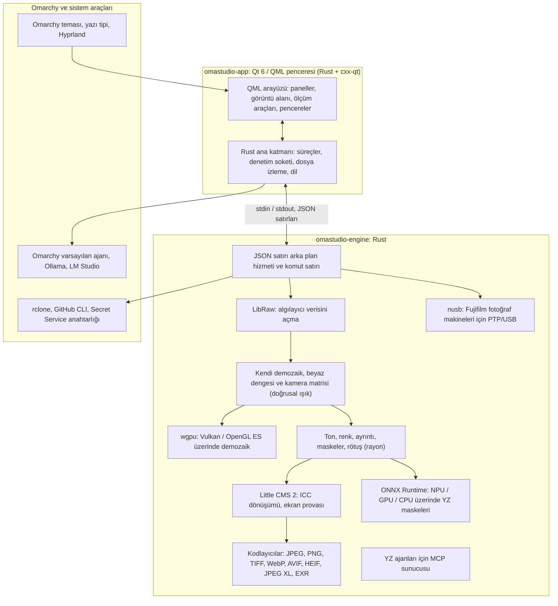

# OmaStudio'da kullanılan teknolojiler

**OmaStudio: The Complete Medium Format RAW Editor for Omarchy**

[Tüm diller](../README.md) · [Kullanım kılavuzu](../guide/tr.md) · [README](../../README.tr.md)

Bu sayfa OmaStudio'nun üzerine kurulduğu teknolojileri, her birinin uygulamada ne yaptığını, neden seçildiğini ve lisansını anlatır. OmaStudio'nun kendisi MIT lisansıyla yayımlanır.

## Mimari

Pencere ve motor ayrı süreçlerdir. Pencere bir fotoğrafı hiçbir zaman kendisi çözmez: motora komut gönderir ve motorun yazdığı görüntüleri gösterir. Çözme sırasındaki bir çökme veya takılma arayüzü etkilemez; aynı motor komut satırına, betiklere ve YZ ajanlarına da hizmet eder.

## Uygulama

| Teknoloji | OmaStudio'daki görevi | Neden | Lisans |
| :--- | :--- | :--- | :--- |
| **Rust** (1.99, edition 2024) | Motorun ve uygulama ana katmanının dili | Güvenilmeyen dosyaları ayrıştıran kod için bellek güvenliği, yerel hız ve iki süreç için tek dil | MIT / Apache-2.0 |
| **Qt 6** (6.12, Qt Quick / QML) | Arayüz: paneller, görüntü alanı, ölçüm araçları, pencereler | Yerel Wayland desteği ve kesirli ölçekleme, sağdan sola düzen ve Qt Linguist çeviri sistemiyle GPU'da çizilen arayüz | LGPL-3.0 |
| **cxx-qt** (0.10) | Rust ile Qt'yi bağlar: `Process`, `Host` türleri ve denetim soketi QML'den kullanılan Rust nesneleridir | Elle yazılmış C++ olmadan iki yönde güvenli bağlantı | MIT / Apache-2.0 |
| **Qt Wayland** | Pencereyi yerel bir Wayland istemcisi olarak çalıştırır (uygulama kimliği `omastudio`) | Omarchy, Wayland üzerinde Hyprland çalıştırır; Hyprland pencere kuralları uygulama kimliğiyle eşleşebilir | LGPL-3.0 |
| **zenity** | Dosya ve klasör pencereleri | Küçük ve her Omarchy kurulumunda mevcut | LGPL-2.1+ |

QML dosyaları Qt kaynakları olarak ikili dosyanın içine derlenir; böylece kurulu bir sürüm başıboş arayüz dosyalarıyla hiçbir zaman karışmaz.

## RAW motoru

| Teknoloji | OmaStudio'daki görevi | Neden | Lisans |
| :--- | :--- | :--- | :--- |
| **LibRaw** (0.22) | RAW kapsayıcısını okur; algılayıcı verisini, meta verileri ve gömülü önizlemeleri açar | Fujifilm GFX, Hasselblad, Phase One ve Leaf dahil, kitaplık olarak sunulan en geniş fotoğraf makinesi desteği | LGPL-2.1 veya CDDL-1.0 (dinamik bağlı) |
| **Kendi işleme hattı** | Siyah seviyesi, beyaz dengesi, X-Trans ve Bayer demozaikleme, kamera renk matrisi, objektif düzeltmeleri; hepsi doğrusal ışık üzerinde | Algılayıcıdan itibaren renk üzerinde denetim ve dışa aktarmaya kadar 16 bit yol; demozaik her piksel için dört yönlü aday arasından seçer | MIT (OmaStudio) |
| **rayon** (1.12) | Tüm CPU çekirdeklerinde paralel işleme | Elle yazılmış iş parçacığı havuzları olmadan veri paralelliği | MIT / Apache-2.0 |
| **wgpu** (30) | Vulkan (NVIDIA, AMD, Intel, Qualcomm Adreno) veya OpenGL ES üzerinden, GPU sınırlarına sığan şeritler halinde GPU'da demozaikleme | WGSL ile yazılmış, her GPU üreticisi için tek kod yolu; sonuç 65535'te bir seviye içinde CPU yoluyla aynıdır | MIT / Apache-2.0 |
| **Little CMS 2** (`lcms2` crate'i ile) | ICC profilleri, dışa aktarma renk alanına dönüşüm, oluşturma amaçları, ekran provası ve gamut uyarısı | Açık kaynaklı başvuru renk yönetimi motoru | MIT |
| **image-rs**, **tiff**, **exr** | PNG, JPEG, TIFF, WebP, OpenEXR, Radiance HDR ve PNM okuma ve yazma | Bellek kullanımı sınırlı saf Rust kodekleri | MIT / Apache-2.0; exr: BSD-3-Clause |
| **libjxl**, **libavif**, **libheif**, **libwebp** | JPEG XL, AVIF, HEIF ve kayıplı WebP dışa aktarma | Bu biçimlerin başvuru kodlayıcıları | BSD-3-Clause, BSD-2-Clause, LGPL-3.0, BSD-3-Clause |
| **ExifTool** (isteğe bağlı) | Fotoğraf makinesinin EXIF bilgilerini dışa aktarılan dosyalara taşır | OmaStudio'nun dışa aktardığı her biçime meta veri yazar | Artistic / GPL (ayrı program) |
| **Lensfun verileri** (isteğe bağlı) | Orta format objektifler için objektif profilleri | Çalışma anında okunan, geniş ve bakımı yapılan bir objektif veritabanı | Veri CC BY-SA 3.0 |

Renk hattı doğrusal ışıkta çalışır: pozlama fotoğrafik bir EV adımıdır ve beyaz dengesi ışık üzerinde fotoğraf makinesinin kendi çarpanları gibi etki eder. Görüntüler yaratıcı ton ve renk modüllerinden önce bir kez ekran kodlamasına çevrilir ve dışa aktarmada Little CMS ile dönüştürülür.

## Yapay zekâ

| Teknoloji | OmaStudio'daki görevi | Neden | Lisans |
| :--- | :--- | :--- | :--- |
| **ONNX Runtime** (`ort` crate'i ile, çalışma anında yüklenir) | **YZ Özne** ve **YZ Gökyüzü** maskeleri için bölütleme modellerini çalıştırır | NPU, GPU ve CPU için tek çalışma ortamı; isteğe bağlıdır, OmaStudio onsuz da açılır | MIT |
| **Yürütme sağlayıcıları** | OpenVINO (Intel Core Ultra NPU), QNN (Snapdragon X NPU), Vitis AI (AMD Ryzen AI NPU), CUDA, MIGraphX, WebGPU, XNNPACK | Bilgisayardaki en hızlı hızlandırıcıyı kullanır, gerekirse CPU'ya döner | Her sağlayıcının kendi lisansı |
| **Omarchy varsayılan ajanı** (Claude Code veya Codex) | Düzenleme asistanı ve YZ sohbeti, `omarchy-default-agent` ile seçilen ajanı kendi oturum açmasıyla kullanır | OmaStudio'da ek hesap veya anahtar gerekmez | Ajanın kendi koşulları |
| **Ollama**, **LM Studio** | Düzenleme asistanı için yerel görüntü modelleri | Fotoğraflar bilgisayarda kalır | MIT; LM Studio: tescilli |
| **Bulut sağlayıcıları** (Anthropic, OpenAI, OpenRouter, Google Gemini) | Düzenleme asistanı için `curl` ile erişilen isteğe bağlı sağlayıcılar | Anahtarlar anahtarlıkta saklanır ve stdin üzerinden aktarılır, hiçbir zaman komut satırına konmaz | Sağlayıcının kendi koşulları |
| **Model Context Protocol** | `omastudio mcp`, YZ ajanlarının fotoğrafları incelemesini, işlemesini, dışa aktarmasını ve pencereyi yönetmesini sağlar | Pek çok ajanın desteklediği açık bir protokol | Açık belirtim |

Asistanın yanıtı bir JSON şemasıyla sınırlanır ve uygulanmadan önce her denetimin aralığına kısılır; her düzenleme geri alınabilir.

## Fotoğraf makineleri

| Teknoloji | OmaStudio'daki görevi | Neden | Lisans |
| :--- | :--- | :--- | :--- |
| **nusb** (0.2) | PTP katmanı için USB erişimi | Saf Rust; libusb veya gphoto2 gerekmez | MIT / Apache-2.0 |
| **PTP / Fujifilm protokolü** | C1–C7 özel ayarları, fotoğraf makinesine yazılan tarifler, fotoğraf makinesinde RAW dönüştürme | Gözlemden temiz oda yöntemiyle belgelendi; üretici kodu içermez | MIT (OmaStudio) |
| **udev kuralı** | Oturum açmış kullanıcıya PTP modundaki Fujifilm fotoğraf makinelerine erişim verir | Fotoğraf makinesi kullanmak için root gerekmez | MIT (OmaStudio) |

## Bulut hesapları

| Teknoloji | OmaStudio'daki görevi | Neden | Lisans |
| :--- | :--- | :--- | :--- |
| **rclone** | Google Drive, OneDrive, Dropbox, Box, pCloud ve Yandex Disk: oturum açma, gezinme, indirme, yükleme | Tarayıcıda OAuth ile pek çok hizmet için tek ve denenmiş bir istemci | MIT |
| **GitHub CLI** (`gh`) | GitHub oturumu (aygıt akışı) ve özel `OmaStudio` deposu | GitHub'ın kendi istemcisi; belirtecini anahtarlıkta tutar | MIT |
| **libsecret** / Secret Service (`secret-tool`, `gnome-keyring`) | OmaStudio'nun şifreli rclone yapılandırmasının anahtarını ve YZ sağlayıcı anahtarlarını tutar | Gizli bilgiler hiçbir zaman düz metin olarak saklanmaz | LGPL-2.1+ |

## Omarchy tümleştirmesi

- **Tema.** Her renk etkin Omarchy temasından (`~/.local/state/omarchy/current/theme/colors.toml`) gelir ve tema değiştiğinde canlı olarak değişir.
- **Yazı tipi.** Arayüz Omarchy'nin yazı tipini kullanır (`omarchy-font-set`, fontconfig üzerinden okunur) ve metni Omarchy kabuğunun temel boyutuna göre ölçekler.
- **Hyprland.** Köşeler Hyprland'in yuvarlaklığını izler; pencere `omastudio` uygulama kimliğine sahip olağan bir Wayland istemcisidir.
- **Varsayılan ajan.** OmaStudio `~/.config/omarchy/defaults/agent` dosyasını canlı olarak izler.
- **Uygulama menüsü ve çubuk.** Masaüstü girdisi, Omarchy'nin kendi uygulamaları gibi yüksek karşıtlıklı tek renkli bir simge kullanır; `Panel.qml` Omarchy çubuğu için isteğe bağlı bir Quickshell bileşenidir.
- **Dil.** Arayüz sistem dilini izler (`LANGUAGE`, `LC_ALL`, `LC_MESSAGES`, `LANG`, `locale.conf`).

## Diller

| Teknoloji | OmaStudio'daki görevi | Lisans |
| :--- | :--- | :--- |
| **Qt Linguist** (`.ts` dosyaları, `lrelease`) | İkili dosyaya derlenen 30 arayüz dili; Arapça, İbranice ve Farsça için sağdan sola düzen | LGPL-3.0 / GPL-3.0 (derleme aracı) |
| **tools/i18n/check.py** | Bir çeviri eksik olduğunda, İngilizce bırakıldığında, yanlış yazı sistemindeyse veya yer tutucuları uyuşmuyorsa CI'da derlemeyi başarısız sayar | MIT (OmaStudio) |

## Derleme, test ve yayın

| Teknoloji | OmaStudio'daki görevi | Lisans |
| :--- | :--- | :--- |
| Sabitlenmiş araç zinciriyle **Cargo** (`rust-toolchain.toml`) | Motoru ve uygulamayı tek bir çalışma alanı olarak derler; `Cargo.lock` depoya eklenir | MIT / Apache-2.0 |
| **clang**, **pkgconf** | LibRaw ara katmanı için C derleyicisi ve bağlayıcı sürücüsü, kitaplık bulma | LLVM istisnalı Apache-2.0, ISC |
| `archlinux` kapsayıcısında **GitHub Actions** | Her değişiklikte Omarchy'nin kullandığı paketlerle derleme, testler, `clippy -D warnings` ve çeviri denetimi | — |
| **CodeQL** | Rust kodunun ve iş akışlarının statik çözümlemesi | — |
| **Yayın iş akışı** | Bir etikette arşivi derler, SHA-256 sağlama toplamları ve derleme kaynağı onaylarıyla yayımlar | — |
| **PKGBUILD** | Bağımlılıklar, isteğe bağlı bağımlılıklar ve udev kuralıyla Arch paketi | — |

## Güvenlik

- Her harici program temizlenmiş bir ortamla, kendi süreç grubunda, bir süre sınırı ve bir çıktı sınırıyla çalışır.
- Motorun okuduğu her dosyanın bir boyut sınırı vardır; katalog, ayarlar ve yan dosyalar `0600` kipiyle atomik olarak yazılır ve motorun sahibi olduğu klasörlerde simgesel bağlantılar reddedilir.
- Denetim soketi `$XDG_RUNTIME_DIR/omastudio/` içinde bulunur ve yalnızca aynı kullanıcının süreçlerine yanıt verir (`SO_PEERCRED`).
- API anahtarları ve bulut belirteçleri anahtarlıkta kalır ve hiçbir zaman komut satırında görünmez.
- Arayüz tüm değişken metinleri düz metin olarak gösterir.

Ayrıntılar [SECURITY.md](../../SECURITY.md) dosyasındadır.

## Ticari markalar

Fujifilm, GFX, X-Trans, Hasselblad, Phase One, Leica, Pentax, Mamiya ve diğer fotoğraf makinesi adları sahiplerinin ticari markalarıdır ve yalnızca uyumluluğu belirtmek için kullanılır.
