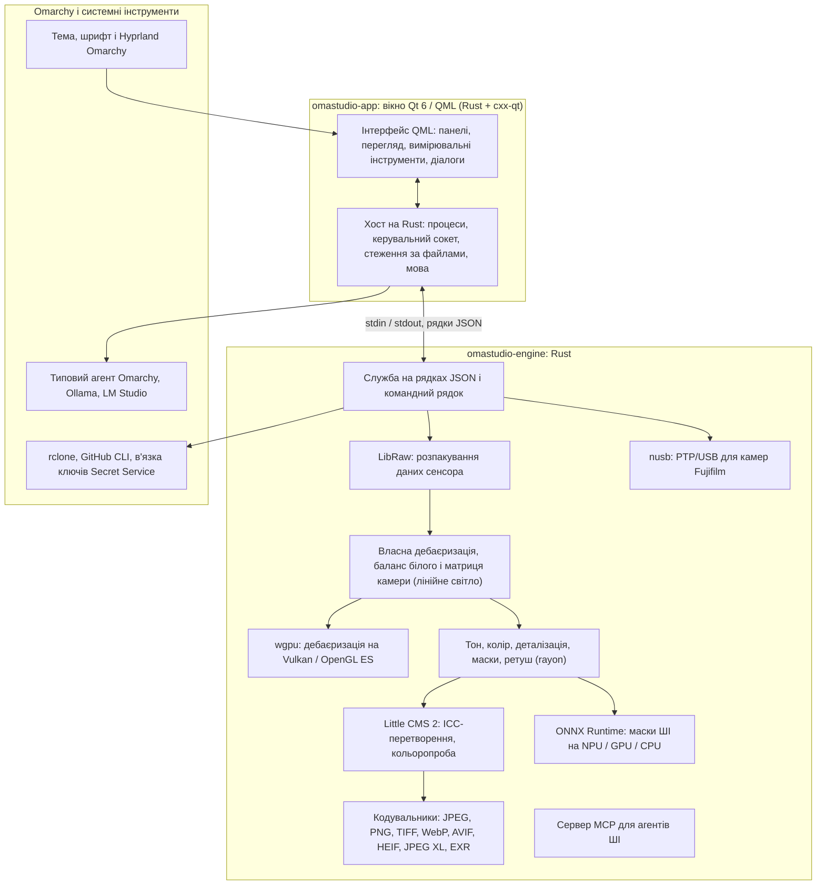

# Технології OmaStudio

**OmaStudio: The Complete Medium Format RAW Editor for Omarchy**

[Усі мови](../README.md) · [Посібник користувача](../guide/uk.md) · [README](../../README.md)

На цій сторінці описано технології, на яких побудовано OmaStudio: що кожна з них робить у застосунку, чому її вибрано і під якою ліцензією вона поширюється. Сам OmaStudio випущено під ліцензією MIT.

## Архітектура

Вікно і рушій — окремі процеси. Вікно ніколи саме не декодує фотографію: воно надсилає команди рушію і показує зображення, які той записує. Збій або зависання під час декодування не може обвалити інтерфейс, а той самий рушій обслуговує командний рядок, скрипти й агентів ШІ.

## Застосунок

| Технологія | Роль в OmaStudio | Чому | Ліцензія |
| :--- | :--- | :--- | :--- |
| **Rust** (1.99, редакція 2024) | Мова рушія і хоста застосунку | Безпека пам'яті для коду, що читає ненадійні файли, нативна швидкість і одна мова для обох процесів | MIT / Apache-2.0 |
| **Qt 6** (6.12, Qt Quick / QML) | Інтерфейс: панелі, перегляд, вимірювальні інструменти, діалоги | Інтерфейс, що малюється на GPU, з нативною підтримкою Wayland і дробового масштабування, розкладкою справа наліво і системою перекладу Qt Linguist | LGPL-3.0 |
| **cxx-qt** (0.10) | Поєднує Rust і Qt: типи `Process`, `Host` і керувальний сокет — об'єкти Rust, які використовує QML | Безпечні прив'язки в обидва боки без написаного вручну C++ | MIT / Apache-2.0 |
| **Qt Wayland** | Запускає вікно як нативний клієнт Wayland (ідентифікатор застосунку `omastudio`) | Omarchy використовує Hyprland на Wayland; правила вікон Hyprland можуть спиратися на ідентифікатор | LGPL-3.0 |
| **zenity** | Діалоги вибору файлів і тек | Невеликий і є в кожній установці Omarchy | LGPL-2.1+ |

Файли QML компілюються у виконуваний файл як ресурси Qt, тому встановлена версія ніколи не змішується зі сторонніми файлами інтерфейсу.

## RAW-рушій

| Технологія | Роль в OmaStudio | Чому | Ліцензія |
| :--- | :--- | :--- | :--- |
| **LibRaw** (0.22) | Читає контейнер RAW і видобуває дані сенсора, метадані й вбудовані попередні перегляди | Найширша підтримка камер серед доступних бібліотек, зокрема Fujifilm GFX, Hasselblad, Phase One і Leaf | LGPL-2.1 або CDDL-1.0 (динамічне компонування) |
| **Власний конвеєр проявлення** | Рівень чорного, баланс білого, дебаєризація X-Trans і Bayer, колірна матриця камери, корекції об'єктива — усе в лінійному світлі | Контроль кольору починаючи із сенсора і 16-бітний шлях до експорту; дебаєризація для кожного пікселя вибирає з чотирьох спрямованих кандидатів | MIT (OmaStudio) |
| **rayon** (1.12) | Паралельна обробка на всіх ядрах CPU | Паралелізм даних без власних пулів потоків | MIT / Apache-2.0 |
| **wgpu** (30) | Дебаєризація на GPU через Vulkan (NVIDIA, AMD, Intel, Qualcomm Adreno) або OpenGL ES смугами, що вкладаються в обмеження GPU | Один шлях коду для всіх виробників GPU, написаний на WGSL; результат збігається зі шляхом на CPU з точністю до одного рівня з 65535 | MIT / Apache-2.0 |
| **Little CMS 2** (через crate `lcms2`) | ICC-профілі, перетворення в колірний простір експорту, методи рендерингу, кольоропроба і попередження про охоплення | Еталонний рушій керування кольором із відкритим кодом | MIT |
| **image-rs**, **tiff**, **exr** | Читання й запис PNG, JPEG, TIFF, WebP, OpenEXR, Radiance HDR і PNM | Кодеки на чистому Rust з обмеженим використанням пам'яті | MIT / Apache-2.0; exr: BSD-3-Clause |
| **libjxl**, **libavif**, **libheif**, **libwebp** | Експорт у JPEG XL, AVIF, HEIF і WebP із втратами | Еталонні кодувальники цих форматів | BSD-3-Clause, BSD-2-Clause, LGPL-3.0, BSD-3-Clause |
| **ExifTool** (необов'язково) | Переносить метадані EXIF камери в експортовані файли | Записує метадані в усі формати, які експортує OmaStudio | Artistic / GPL (окрема програма) |
| **Дані Lensfun** (необов'язково) | Профілі об'єктивів середнього формату | Велика підтримувана база об'єктивів, яку читають під час роботи | Дані CC BY-SA 3.0 |

Колірний конвеєр працює в лінійному світлі: експозиція — фотографічний крок EV, а баланс білого діє на світло так само, як множники самої камери. Зображення кодується для екрана один раз, перед творчими модулями тону й кольору, і перетворюється за допомогою Little CMS під час експорту.

## ШІ

| Технологія | Роль в OmaStudio | Чому | Ліцензія |
| :--- | :--- | :--- | :--- |
| **ONNX Runtime** (через crate `ort`, завантажується під час роботи) | Запускає моделі сегментації для масок **Об'єкт (ШІ)** і **Небо (ШІ)** | Одне середовище виконання для NPU, GPU і CPU; необов'язкове, OmaStudio запускається й без нього | MIT |
| **Постачальники виконання** | OpenVINO (NPU Intel Core Ultra), QNN (NPU Snapdragon X), Vitis AI (NPU AMD Ryzen AI), CUDA, MIGraphX, WebGPU, XNNPACK | Використовується найшвидший прискорювач комп'ютера з відкатом на CPU | Ліцензія кожного постачальника |
| **Типовий агент Omarchy** (Claude Code або Codex) | Асистент редагування і чат зі ШІ використовують агента, вибраного через `omarchy-default-agent`, з його власним входом | Жодних додаткових облікових записів чи ключів в OmaStudio | Умови агента |
| **Ollama**, **LM Studio** | Локальні моделі комп'ютерного зору для асистента редагування | Фотографії залишаються на комп'ютері | MIT; LM Studio: пропрієтарна |
| **Хмарні постачальники** (Anthropic, OpenAI, OpenRouter, Google Gemini) | Необов'язкові постачальники для асистента редагування, доступні через `curl` | Ключі зберігаються у в'язці ключів і передаються через stdin, ніколи — у командному рядку | Умови постачальника |
| **Model Context Protocol** | `omastudio mcp` дає змогу агентам ШІ аналізувати, обробляти, експортувати фотографії й керувати вікном | Відкритий протокол, який підтримують багато агентів | Відкрита специфікація |

Відповідь асистента обмежено схемою JSON і перед застосуванням зведено до діапазону кожного регулятора; будь-яку правку можна скасувати.

## Камери

| Технологія | Роль в OmaStudio | Чому | Ліцензія |
| :--- | :--- | :--- | :--- |
| **nusb** (0.2) | Доступ до USB для рівня PTP | Чистий Rust, без libusb і gphoto2 | MIT / Apache-2.0 |
| **PTP / протокол Fujifilm** | Власні налаштування C1–C7, запис рецептів у камеру, конвертація RAW у камері | Задокументовано методом «чистої кімнати» за спостереженнями; без коду виробника | MIT (OmaStudio) |
| **Правило udev** | Дає користувачеві, що увійшов у систему, доступ до камер Fujifilm у режимі PTP | Для роботи з камерою не потрібен root | MIT (OmaStudio) |

## Хмарні облікові записи

| Технологія | Роль в OmaStudio | Чому | Ліцензія |
| :--- | :--- | :--- | :--- |
| **rclone** | Google Drive, OneDrive, Dropbox, Box, pCloud і Yandex Disk: вхід, перегляд, завантаження, вивантаження | Один перевірений клієнт для багатьох сервісів, з OAuth у браузері | MIT |
| **GitHub CLI** (`gh`) | Вхід до GitHub (device flow) і приватний репозиторій `OmaStudio` | Власний клієнт GitHub; зберігає свій токен у в'язці ключів | MIT |
| **libsecret** / Secret Service (`secret-tool`, `gnome-keyring`) | Зберігає ключ зашифрованої конфігурації rclone OmaStudio і ключі постачальників ШІ | Секрети ніколи не зберігаються відкритим текстом | LGPL-2.1+ |

## Інтеграція з Omarchy

- **Тема.** Кожен колір береться з активної теми Omarchy (`~/.local/state/omarchy/current/theme/colors.toml`) і змінюється одразу зі зміною теми.
- **Шрифт.** Інтерфейс використовує шрифт Omarchy (`omarchy-font-set`, читається через fontconfig) і масштабує текст за базовим розміром оболонки Omarchy.
- **Hyprland.** Кути відповідають заокругленню Hyprland; вікно — звичайний клієнт Wayland з ідентифікатором `omastudio`.
- **Типовий агент.** OmaStudio відстежує `~/.config/omarchy/defaults/agent` на льоту.
- **Меню застосунків і панель.** Ярлик застосунку має контрастну монохромну піктограму, як і власні застосунки Omarchy; `Panel.qml` — необов'язковий віджет Quickshell для панелі Omarchy.
- **Мова.** Інтерфейс відповідає мові системи (`LANGUAGE`, `LC_ALL`, `LC_MESSAGES`, `LANG`, `locale.conf`).

## Мови

| Технологія | Роль в OmaStudio | Ліцензія |
| :--- | :--- | :--- |
| **Qt Linguist** (файли `.ts`, `lrelease`) | 30 мов інтерфейсу, скомпільованих у виконуваний файл; розкладка справа наліво для арабської, івриту й перської | LGPL-3.0 / GPL-3.0 (інструмент збирання) |
| **tools/i18n/check.py** | Зупиняє збирання в CI, якщо переклад відсутній, лишився англійською, написаний не тим письмом або його заповнювачі не збігаються | MIT (OmaStudio) |

## Збирання, тести й випуск

| Технологія | Роль в OmaStudio | Ліцензія |
| :--- | :--- | :--- |
| **Cargo** із закріпленим інструментарієм (`rust-toolchain.toml`) | Збирає рушій і застосунок як один робочий простір; `Cargo.lock` зберігається в репозиторії | MIT / Apache-2.0 |
| **clang**, **pkgconf** | Компілятор C і драйвер компонувальника для прошарку LibRaw, пошук бібліотек | Apache-2.0 з винятком LLVM, ISC |
| **GitHub Actions** у контейнері `archlinux` | Збирання, тести, `clippy -D warnings` і перевірка перекладів під час кожної зміни, з тими самими пакетами, що й в Omarchy | — |
| **CodeQL** | Статичний аналіз коду на Rust і робочих процесів | — |
| **Процес випуску** | Збирає архів за тегом і публікує його з контрольними сумами SHA-256 та атестаціями походження збірки | — |
| **PKGBUILD** | Пакет Arch із залежностями, необов'язковими залежностями і правилом udev | — |

## Безпека

- Кожна зовнішня програма запускається з очищеним оточенням, у власній групі процесів, з обмеженням часу й обсягу виводу.
- Для кожного файлу, який читає рушій, задано граничний розмір; каталог, налаштування і файли правок записуються атомарно з режимом `0600`, а символічні посилання відхиляються там, де тека належить рушію.
- Керувальний сокет розташовано в `$XDG_RUNTIME_DIR/omastudio/`, і він відповідає лише процесам того самого користувача (`SO_PEERCRED`).
- API-ключі й хмарні токени залишаються у в'язці ключів і ніколи не з'являються в командному рядку.
- Інтерфейс показує весь динамічний текст як звичайний текст.

Подробиці — у [SECURITY.md](../../SECURITY.md).

## Торговельні марки

Fujifilm, GFX, X-Trans, Hasselblad, Phase One, Leica, Pentax, Mamiya та інші назви камер є торговельними марками їхніх власників і використовуються лише для зазначення сумісності.
