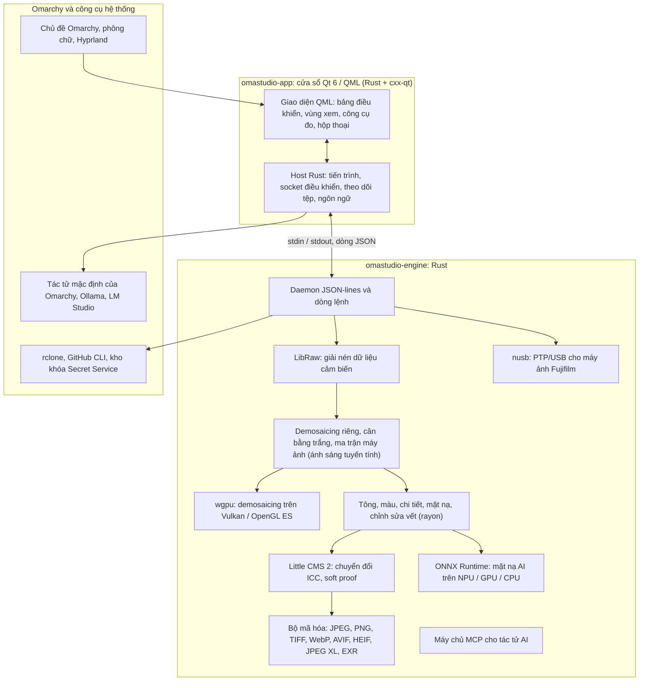

# Công nghệ trong OmaStudio

**OmaStudio: The Complete Medium Format RAW Editor for Omarchy**

[Tất cả ngôn ngữ](../README.md) · [Hướng dẫn sử dụng](../guide/vi.md) · [README](../../README.md)

Trang này mô tả các công nghệ làm nền tảng cho OmaStudio: mỗi công nghệ làm gì trong ứng dụng, vì sao được chọn và dùng giấy phép nào. Bản thân OmaStudio được phát hành theo giấy phép MIT.

## Kiến trúc

Cửa sổ và bộ xử lý là hai tiến trình riêng biệt. Cửa sổ không bao giờ tự giải mã ảnh: nó gửi lệnh tới bộ xử lý và hiển thị các ảnh do bộ xử lý ghi ra. Một sự cố treo hay sập khi giải mã không thể kéo theo giao diện, và cùng một bộ xử lý phục vụ dòng lệnh, script và tác tử AI.

## Ứng dụng

| Công nghệ | Vai trò trong OmaStudio | Lý do | Giấy phép |
| :--- | :--- | :--- | :--- |
| **Rust** (1.99, phiên bản 2024) | Ngôn ngữ của bộ xử lý và host ứng dụng | An toàn bộ nhớ cho mã phân tích các tệp không đáng tin cậy, tốc độ gốc và một ngôn ngữ cho cả hai tiến trình | MIT / Apache-2.0 |
| **Qt 6** (6.12, Qt Quick / QML) | Giao diện: bảng điều khiển, vùng xem, công cụ đo, hộp thoại | Giao diện do GPU vẽ, hỗ trợ Wayland gốc và co giãn phân số, bố cục từ phải sang trái và hệ thống dịch Qt Linguist | LGPL-3.0 |
| **cxx-qt** (0.10) | Nối Rust với Qt: các kiểu host `Process`, `Host` và socket điều khiển là đối tượng Rust được dùng từ QML | Liên kết an toàn theo cả hai chiều mà không cần viết C++ thủ công | MIT / Apache-2.0 |
| **Qt Wayland** | Chạy cửa sổ như một client Wayland gốc (app id `omastudio`) | Omarchy chạy Hyprland trên Wayland; quy tắc cửa sổ của Hyprland có thể khớp theo app id | LGPL-3.0 |
| **zenity** | Hộp thoại tệp và thư mục | Nhỏ gọn và có sẵn trong mọi bản cài Omarchy | LGPL-2.1+ |

Các tệp QML được biên dịch vào tệp thực thi dưới dạng tài nguyên Qt, nên một phiên bản đã cài không bao giờ bị lẫn với các tệp giao diện rời rạc.

## Bộ xử lý RAW

| Công nghệ | Vai trò trong OmaStudio | Lý do | Giấy phép |
| :--- | :--- | :--- | :--- |
| **LibRaw** (0.22) | Đọc vỏ chứa RAW và giải nén dữ liệu cảm biến, siêu dữ liệu và ảnh xem trước nhúng | Hỗ trợ máy ảnh rộng nhất hiện có dưới dạng thư viện, gồm Fujifilm GFX, Hasselblad, Phase One và Leaf | LGPL-2.1 hoặc CDDL-1.0 (liên kết động) |
| **Chuỗi xử lý riêng** | Mức đen, cân bằng trắng, demosaicing X-Trans và Bayer, ma trận màu của máy ảnh, hiệu chỉnh ống kính, tất cả trên ánh sáng tuyến tính | Kiểm soát màu từ cảm biến trở đi và đường xử lý 16-bit đến khi xuất; demosaicing chọn giữa bốn ứng viên theo hướng cho mỗi điểm ảnh | MIT (OmaStudio) |
| **rayon** (1.12) | Xử lý song song trên mọi nhân CPU | Song song dữ liệu mà không cần tự viết thread pool | MIT / Apache-2.0 |
| **wgpu** (30) | Demosaicing trên GPU qua Vulkan (NVIDIA, AMD, Intel, Qualcomm Adreno) hoặc OpenGL ES, theo từng dải vừa trong giới hạn của GPU | Một đường mã cho mọi hãng GPU, viết bằng WGSL; kết quả khớp với đường CPU trong phạm vi một mức trên 65535 | MIT / Apache-2.0 |
| **Little CMS 2** (qua crate `lcms2`) | Hồ sơ ICC, chuyển sang không gian màu xuất, mục đích kết xuất, soft proof và cảnh báo gam màu | Bộ máy tham chiếu mã nguồn mở cho quản lý màu | MIT |
| **image-rs**, **tiff**, **exr** | Đọc và ghi PNG, JPEG, TIFF, WebP, OpenEXR, Radiance HDR và PNM | Codec thuần Rust với mức dùng bộ nhớ có giới hạn | MIT / Apache-2.0; exr: BSD-3-Clause |
| **libjxl**, **libavif**, **libheif**, **libwebp** | Xuất JPEG XL, AVIF, HEIF và WebP nén mất dữ liệu | Bộ mã hóa tham chiếu cho các định dạng này | BSD-3-Clause, BSD-2-Clause, LGPL-3.0, BSD-3-Clause |
| **ExifTool** (tùy chọn) | Chuyển siêu dữ liệu EXIF của máy ảnh vào tệp xuất | Ghi siêu dữ liệu vào mọi định dạng OmaStudio xuất ra | Artistic / GPL (chương trình riêng) |
| **Dữ liệu Lensfun** (tùy chọn) | Hồ sơ ống kính cho ống kính định dạng trung bình | Cơ sở dữ liệu ống kính lớn, được duy trì, đọc lúc chạy | Dữ liệu CC BY-SA 3.0 |

Chuỗi màu hoạt động trên ánh sáng tuyến tính: phơi sáng là một bước EV nhiếp ảnh và cân bằng trắng tác động lên ánh sáng giống các hệ số nhân của chính máy ảnh. Ảnh được mã hóa cho màn hình một lần, trước các mô-đun tông và màu sáng tạo, rồi được chuyển đổi bằng Little CMS khi xuất.

## AI

| Công nghệ | Vai trò trong OmaStudio | Lý do | Giấy phép |
| :--- | :--- | :--- | :--- |
| **ONNX Runtime** (qua crate `ort`, nạp lúc chạy) | Chạy mô hình phân đoạn cho mặt nạ **Chủ thể AI** và **Bầu trời AI** | Một runtime cho NPU, GPU và CPU; là tùy chọn, nên OmaStudio vẫn khởi động khi không có | MIT |
| **Execution provider** | OpenVINO (NPU Intel Core Ultra), QNN (NPU Snapdragon X), Vitis AI (NPU AMD Ryzen AI), CUDA, MIGraphX, WebGPU, XNNPACK | Dùng bộ tăng tốc nhanh nhất trong máy và quay về CPU khi cần | Giấy phép riêng của từng provider |
| **Tác tử mặc định của Omarchy** (Claude Code hoặc Codex) | **Trợ lý chỉnh sửa** và **Trò chuyện với AI** dùng tác tử được chọn bằng `omarchy-default-agent`, với đăng nhập riêng của nó | Không cần thêm tài khoản hay khóa trong OmaStudio | Điều khoản riêng của tác tử |
| **Ollama**, **LM Studio** | Mô hình thị giác cục bộ cho trợ lý chỉnh sửa | Ảnh ở lại trên máy tính | MIT; LM Studio: độc quyền |
| **Nhà cung cấp đám mây** (Anthropic, OpenAI, OpenRouter, Google Gemini) | Nhà cung cấp tùy chọn cho trợ lý chỉnh sửa, truy cập bằng `curl` | Khóa được lưu trong kho khóa và truyền qua stdin, không bao giờ trên dòng lệnh | Điều khoản riêng của nhà cung cấp |
| **Model Context Protocol** | `omastudio mcp` cho phép tác tử AI kiểm tra, kết xuất, xuất ảnh và điều khiển cửa sổ | Giao thức mở được nhiều tác tử hỗ trợ | Đặc tả mở |

Câu trả lời của trợ lý bị giới hạn trong một lược đồ JSON và được kẹp vào khoảng giá trị của từng điều khiển trước khi áp dụng, và mọi chỉnh sửa đều có thể hoàn tác.

## Máy ảnh

| Công nghệ | Vai trò trong OmaStudio | Lý do | Giấy phép |
| :--- | :--- | :--- | :--- |
| **nusb** (0.2) | Truy cập USB cho lớp PTP | Thuần Rust, không cần libusb hay gphoto2 | MIT / Apache-2.0 |
| **Giao thức PTP / Fujifilm** | Thiết lập tùy chỉnh C1–C7, công thức ghi vào máy ảnh, chuyển đổi RAW trong máy ảnh | Được tài liệu hóa theo phương pháp clean room từ quan sát; không có mã của nhà sản xuất | MIT (OmaStudio) |
| **Quy tắc udev** | Cho người dùng đang đăng nhập quyền truy cập máy ảnh Fujifilm ở chế độ PTP | Không cần root để dùng máy ảnh | MIT (OmaStudio) |

## Tài khoản đám mây

| Công nghệ | Vai trò trong OmaStudio | Lý do | Giấy phép |
| :--- | :--- | :--- | :--- |
| **rclone** | Google Drive, OneDrive, Dropbox, Box, pCloud và Yandex Disk: đăng nhập, duyệt, tải xuống, tải lên | Một client đã được kiểm chứng cho nhiều dịch vụ, với OAuth trong trình duyệt | MIT |
| **GitHub CLI** (`gh`) | Đăng nhập GitHub (device flow) và kho riêng tư `OmaStudio` | Client chính thức của GitHub; giữ token trong kho khóa | MIT |
| **libsecret** / Secret Service (`secret-tool`, `gnome-keyring`) | Giữ khóa của cấu hình rclone đã mã hóa của OmaStudio và khóa của các nhà cung cấp AI | Bí mật không bao giờ được lưu dưới dạng văn bản thường | LGPL-2.1+ |

## Tích hợp với Omarchy

- **Chủ đề.** Mọi màu đều lấy từ chủ đề Omarchy đang dùng (`~/.local/state/omarchy/current/theme/colors.toml`) và thay đổi ngay khi đổi chủ đề.
- **Phông chữ.** Giao diện dùng phông chữ của Omarchy (`omarchy-font-set`, đọc qua fontconfig) và co giãn chữ theo cỡ cơ sở của shell Omarchy.
- **Hyprland.** Góc bo theo thiết lập của Hyprland; cửa sổ là một client Wayland thông thường với app id `omastudio`.
- **Tác tử mặc định.** OmaStudio theo dõi `~/.config/omarchy/defaults/agent` theo thời gian thực.
- **Menu ứng dụng và thanh.** Mục desktop dùng biểu tượng đơn sắc độ tương phản cao như các ứng dụng của Omarchy; `Panel.qml` là một widget Quickshell tùy chọn cho thanh Omarchy.
- **Ngôn ngữ.** Giao diện theo ngôn ngữ hệ thống (`LANGUAGE`, `LC_ALL`, `LC_MESSAGES`, `LANG`, `locale.conf`).

## Ngôn ngữ

| Công nghệ | Vai trò trong OmaStudio | Giấy phép |
| :--- | :--- | :--- |
| **Qt Linguist** (tệp `.ts`, `lrelease`) | 30 ngôn ngữ giao diện, biên dịch vào tệp thực thi; bố cục từ phải sang trái cho tiếng Ả Rập, tiếng Do Thái và tiếng Ba Tư | LGPL-3.0 / GPL-3.0 (công cụ build) |
| **tools/i18n/check.py** | Làm build CI thất bại khi một bản dịch bị thiếu, còn để tiếng Anh, sai hệ chữ viết hoặc có placeholder không khớp | MIT (OmaStudio) |

## Build, kiểm thử và phát hành

| Công nghệ | Vai trò trong OmaStudio | Giấy phép |
| :--- | :--- | :--- |
| **Cargo** với toolchain cố định (`rust-toolchain.toml`) | Build bộ xử lý và ứng dụng thành một workspace; `Cargo.lock` được đưa vào kho mã | MIT / Apache-2.0 |
| **clang**, **pkgconf** | Trình biên dịch C và trình điều khiển linker cho lớp trung gian LibRaw, tìm thư viện | Apache-2.0 kèm ngoại lệ LLVM, ISC |
| **GitHub Actions** trong container `archlinux` | Build, kiểm thử, `clippy -D warnings` và kiểm tra bản dịch ở mỗi thay đổi, với cùng các gói mà Omarchy dùng | — |
| **CodeQL** | Phân tích tĩnh mã Rust và các workflow | — |
| **Workflow phát hành** | Build gói khi có tag và phát hành kèm checksum SHA-256 và chứng thực nguồn gốc bản build | — |
| **PKGBUILD** | Gói Arch với phụ thuộc, phụ thuộc tùy chọn và quy tắc udev | — |

## Bảo mật

- Mọi chương trình bên ngoài chạy với môi trường đã được dọn sạch, trong nhóm tiến trình riêng, với giới hạn thời gian và giới hạn đầu ra.
- Mọi tệp bộ xử lý đọc đều có giới hạn kích thước; danh mục, thiết lập và tệp đi kèm được ghi nguyên tử với quyền `0600`, và liên kết tượng trưng bị từ chối ở những thư mục do bộ xử lý quản lý.
- Socket điều khiển nằm trong `$XDG_RUNTIME_DIR/omastudio/` và chỉ trả lời tiến trình của cùng người dùng (`SO_PEERCRED`).
- Khóa API và token đám mây ở lại trong kho khóa và không bao giờ xuất hiện trên dòng lệnh.
- Giao diện hiển thị mọi văn bản động dưới dạng văn bản thuần.

Chi tiết có trong [SECURITY.md](../../SECURITY.md).

## Nhãn hiệu

Fujifilm, GFX, X-Trans, Hasselblad, Phase One, Leica, Pentax, Mamiya và các tên máy ảnh khác là nhãn hiệu của chủ sở hữu tương ứng và chỉ được dùng để mô tả khả năng tương thích.
