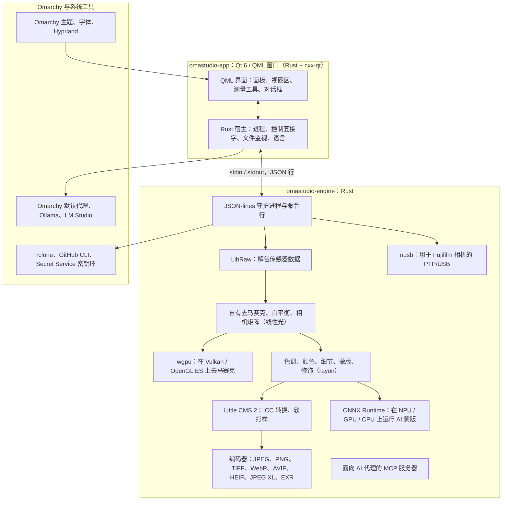

# OmaStudio 所用技术

**OmaStudio: The Complete Medium Format RAW Editor for Omarchy**

[所有语言](../README.md) · [用户指南](../guide/zh_CN.md) · [README](../../README.md)

本页介绍 OmaStudio 所基于的技术：每项技术在应用中的作用、选择它的原因及其许可证。OmaStudio 本身以 MIT 许可证发布。

## 架构

窗口和引擎是两个独立的进程。窗口本身从不解码照片：它向引擎发送命令，并显示引擎写出的图像。解码过程中的崩溃或卡死不会连带界面，同一个引擎也服务于命令行、脚本和 AI 代理。

## 应用

| 技术 | 在 OmaStudio 中的作用 | 原因 | 许可证 |
| :--- | :--- | :--- | :--- |
| **Rust**（1.99，2024 版） | 引擎和应用宿主的编程语言 | 为解析不可信文件的代码提供内存安全，具备原生速度，两个进程使用同一种语言 | MIT / Apache-2.0 |
| **Qt 6**（6.12，Qt Quick / QML） | 界面：面板、视图区、测量工具、对话框 | 由 GPU 绘制的界面，原生支持 Wayland 和分数缩放，支持从右到左布局和 Qt Linguist 翻译体系 | LGPL-3.0 |
| **cxx-qt**（0.10） | 连接 Rust 与 Qt：宿主类型 `Process`、`Host` 和控制套接字都是在 QML 中使用的 Rust 对象 | 无需手写 C++ 即可获得双向安全绑定 | MIT / Apache-2.0 |
| **Qt Wayland** | 将窗口作为原生 Wayland 客户端运行（app id 为 `omastudio`） | Omarchy 在 Wayland 上运行 Hyprland；Hyprland 的窗口规则可以匹配 app id | LGPL-3.0 |
| **zenity** | 文件和文件夹对话框 | 体积小，每个 Omarchy 安装中都有 | LGPL-2.1+ |

QML 文件作为 Qt 资源编译进二进制文件，因此已安装的版本不会与零散的界面文件混在一起。

## RAW 引擎

| 技术 | 在 OmaStudio 中的作用 | 原因 | 许可证 |
| :--- | :--- | :--- | :--- |
| **LibRaw**（0.22） | 读取 RAW 容器，解包传感器数据、元数据和嵌入的预览 | 以库形式提供的最广泛的相机支持，包括 Fujifilm GFX、Hasselblad、Phase One 和 Leaf | LGPL-2.1 或 CDDL-1.0（动态链接） |
| **自有冲洗流程** | 黑电平、白平衡、X-Trans 和拜耳去马赛克、相机色彩矩阵、镜头校正，全部在线性光中完成 | 从传感器开始掌控颜色，并保持到导出的 16 位通路；去马赛克为每个像素从四个方向候选中选择 | MIT（OmaStudio） |
| **rayon**（1.12） | 在所有 CPU 核心上并行处理 | 无需手写线程池即可实现数据并行 | MIT / Apache-2.0 |
| **wgpu**（30） | 通过 Vulkan（NVIDIA、AMD、Intel、Qualcomm Adreno）或 OpenGL ES 在 GPU 上去马赛克，按适合 GPU 限制的条带处理 | 用 WGSL 编写、适用于所有 GPU 厂商的同一条代码路径；结果与 CPU 路径的差异不超过 65535 级中的一级 | MIT / Apache-2.0 |
| **Little CMS 2**（通过 `lcms2` crate） | ICC 配置文件、转换到导出色彩空间、渲染意图、软打样和色域警告 | 开源色彩管理的参考引擎 | MIT |
| **image-rs**、**tiff**、**exr** | 读写 PNG、JPEG、TIFF、WebP、OpenEXR、Radiance HDR 和 PNM | 内存占用有上限的纯 Rust 编解码器 | MIT / Apache-2.0；exr：BSD-3-Clause |
| **libjxl**、**libavif**、**libheif**、**libwebp** | 导出 JPEG XL、AVIF、HEIF 和有损 WebP | 这些格式的参考编码器 | BSD-3-Clause、BSD-2-Clause、LGPL-3.0、BSD-3-Clause |
| **ExifTool**（可选） | 将相机的 EXIF 元数据带入导出文件 | 可向 OmaStudio 导出的所有格式写入元数据 | Artistic / GPL（独立程序） |
| **Lensfun 数据**（可选） | 中画幅镜头的镜头配置文件 | 规模大、持续维护的镜头数据库，在运行时读取 | 数据 CC BY-SA 3.0 |

色彩流程在线性光中工作：曝光是摄影意义上的 EV 档，白平衡像相机自身的乘数一样作用于光。图像在创意色调和颜色模块之前只做一次显示编码，导出时再用 Little CMS 转换。

## AI

| 技术 | 在 OmaStudio 中的作用 | 原因 | 许可证 |
| :--- | :--- | :--- | :--- |
| **ONNX Runtime**（通过 `ort` crate，运行时加载） | 运行 **AI 主体** 和 **AI 天空** 蒙版的分割模型 | 一个运行时同时覆盖 NPU、GPU 和 CPU；属于可选项，没有它 OmaStudio 也能启动 | MIT |
| **执行提供程序** | OpenVINO（Intel Core Ultra NPU）、QNN（Snapdragon X NPU）、Vitis AI（AMD Ryzen AI NPU）、CUDA、MIGraphX、WebGPU、XNNPACK | 使用电脑上最快的加速器，必要时回退到 CPU | 各提供程序自己的许可证 |
| **Omarchy 默认代理**（Claude Code 或 Codex） | **编辑助手** 和 **AI 对话** 使用通过 `omarchy-default-agent` 选定的代理及其自身登录 | OmaStudio 中无需额外账户或密钥 | 代理自身的条款 |
| **Ollama**、**LM Studio** | 供编辑助手使用的本地视觉模型 | 照片留在电脑上 | MIT；LM Studio：专有 |
| **云服务商**（Anthropic、OpenAI、OpenRouter、Google Gemini） | 编辑助手的可选服务商，通过 `curl` 访问 | 密钥保存在密钥环中，经由 stdin 传递，从不出现在命令行上 | 服务商自身的条款 |
| **Model Context Protocol** | `omastudio mcp` 让 AI 代理可以检查、渲染、导出照片并控制窗口 | 许多代理都支持的开放协议 | 开放规范 |

助手的回答被限制在 JSON 架构内，并在应用前被限定到每个控件的取值范围，每次编辑都可以撤销。

## 相机

| 技术 | 在 OmaStudio 中的作用 | 原因 | 许可证 |
| :--- | :--- | :--- | :--- |
| **nusb**（0.2） | PTP 层的 USB 访问 | 纯 Rust，不需要 libusb 或 gphoto2 | MIT / Apache-2.0 |
| **PTP / Fujifilm 协议** | 自定义设置 C1–C7、写入相机的配方、相机内 RAW 转换 | 通过观察以净室方式记录；不含厂商代码 | MIT（OmaStudio） |
| **udev 规则** | 让已登录用户访问处于 PTP 模式的 Fujifilm 相机 | 使用相机无需 root 权限 | MIT（OmaStudio） |

## 云账户

| 技术 | 在 OmaStudio 中的作用 | 原因 | 许可证 |
| :--- | :--- | :--- | :--- |
| **rclone** | Google Drive、OneDrive、Dropbox、Box、pCloud 和 Yandex Disk：登录、浏览、下载、上传 | 一个久经考验的客户端支持多种服务，在浏览器中完成 OAuth | MIT |
| **GitHub CLI**（`gh`） | GitHub 登录（设备流程）和私有仓库 `OmaStudio` | GitHub 官方客户端；其令牌保存在密钥环中 | MIT |
| **libsecret** / Secret Service（`secret-tool`、`gnome-keyring`） | 保存 OmaStudio 加密 rclone 配置的密钥和 AI 服务商的密钥 | 机密信息从不以明文存储 | LGPL-2.1+ |

## 与 Omarchy 的集成

- **主题。** 所有颜色都来自当前的 Omarchy 主题（`~/.local/state/omarchy/current/theme/colors.toml`），切换主题时立即生效。
- **字体。** 界面使用 Omarchy 的字体（`omarchy-font-set`，通过 fontconfig 读取），并按 Omarchy shell 的基础字号缩放文字。
- **Hyprland。** 圆角跟随 Hyprland 的设置；窗口是 app id 为 `omastudio` 的普通 Wayland 客户端。
- **默认代理。** OmaStudio 实时跟随 `~/.config/omarchy/defaults/agent`。
- **应用菜单与状态栏。** 桌面项使用与 Omarchy 自带应用一样的高对比度单色图标；`Panel.qml` 是用于 Omarchy 状态栏的可选 Quickshell 组件。
- **语言。** 界面跟随系统语言（`LANGUAGE`、`LC_ALL`、`LC_MESSAGES`、`LANG`、`locale.conf`）。

## 语言

| 技术 | 在 OmaStudio 中的作用 | 许可证 |
| :--- | :--- | :--- |
| **Qt Linguist**（`.ts` 文件、`lrelease`） | 编译进二进制文件的 30 种界面语言；阿拉伯语、希伯来语和波斯语使用从右到左布局 | LGPL-3.0 / GPL-3.0（构建工具） |
| **tools/i18n/check.py** | 当翻译缺失、仍为英文、文字系统错误或占位符不匹配时，使 CI 构建失败 | MIT（OmaStudio） |

## 构建、测试与发布

| 技术 | 在 OmaStudio 中的作用 | 许可证 |
| :--- | :--- | :--- |
| 带固定工具链（`rust-toolchain.toml`）的 **Cargo** | 将引擎和应用作为一个工作区构建；`Cargo.lock` 已提交到仓库 | MIT / Apache-2.0 |
| **clang**、**pkgconf** | LibRaw 中间层的 C 编译器和链接器驱动，以及库的查找 | Apache-2.0（含 LLVM 例外）、ISC |
| 在 `archlinux` 容器中运行的 **GitHub Actions** | 每次变更都用与 Omarchy 相同的软件包进行构建、测试、`clippy -D warnings` 和翻译检查 | — |
| **CodeQL** | 对 Rust 代码和工作流进行静态分析 | — |
| **发布工作流** | 在打标签时构建发布包，并附带 SHA-256 校验和与构建来源证明一起发布 | — |
| **PKGBUILD** | 包含依赖、可选依赖和 udev 规则的 Arch 软件包 | — |

## 安全

- 每个外部程序都在清空的环境、独立的进程组中运行，并有时间限制和输出限制。
- 引擎读取的每个文件都有大小上限；目录、设置和附属文件以 `0600` 权限原子写入，在引擎所管理的文件夹中拒绝符号链接。
- 控制套接字位于 `$XDG_RUNTIME_DIR/omastudio/`，只响应同一用户的进程（`SO_PEERCRED`）。
- API 密钥和云令牌保存在密钥环中，从不出现在命令行上。
- 界面将所有动态文本按纯文本显示。

详情见 [SECURITY.md](../../SECURITY.md)。

## 商标

Fujifilm、GFX、X-Trans、Hasselblad、Phase One、Leica、Pentax、Mamiya 以及其他相机名称均为其各自所有者的商标，此处仅用于说明兼容性。
