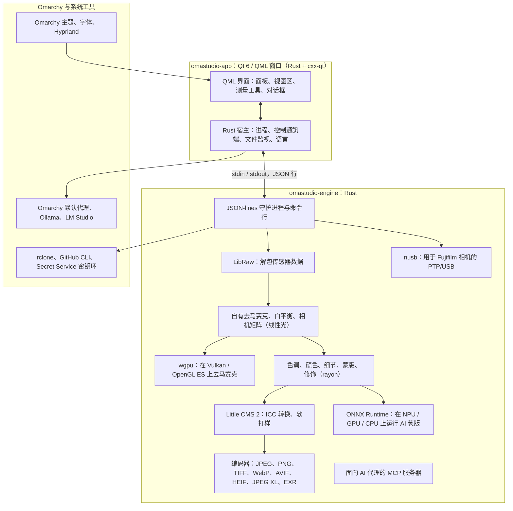

# OmaStudio 所用技術

**OmaStudio: The Complete Medium Format RAW Editor for Omarchy**

[所有語言](../README.md) · [使用者指南](../guide/zh_TW.md) · [README](../../README.md)

本頁介紹 OmaStudio 所基於的技術：每項技術在應用中的作用、選擇它的原因及其許可證。OmaStudio 本身以 MIT 許可證發行。

## 架構

視窗和引擎是兩個獨立的程序。視窗本身從不解碼照片：它向引擎傳送命令，並顯示引擎寫出的影像。解碼過程中的崩潰或卡死不會連帶介面，同一個引擎也服務於命令列、指令碼和 AI 代理。

## 應用

| 技術 | 在 OmaStudio 中的作用 | 原因 | 許可證 |
| :--- | :--- | :--- | :--- |
| **Rust**（1.99，2024 版） | 引擎和應用宿主的程式語言 | 為解析不可信檔案的程式碼提供記憶體安全，具備原生速度，兩個程序使用同一種語言 | MIT / Apache-2.0 |
| **Qt 6**（6.12，Qt Quick / QML） | 介面：面板、檢視區、測量工具、對話方塊 | 由 GPU 繪製的介面，原生支援 Wayland 和分數縮放，支援從右到左佈局和 Qt Linguist 翻譯體系 | LGPL-3.0 |
| **cxx-qt**（0.10） | 連線 Rust 與 Qt：宿主型別 `Process`、`Host` 和控制通訊端都是在 QML 中使用的 Rust 物件 | 無需手寫 C++ 即可獲得雙向安全繫結 | MIT / Apache-2.0 |
| **Qt Wayland** | 將視窗作為原生 Wayland 客戶端執行（app id 為 `omastudio`） | Omarchy 在 Wayland 上執行 Hyprland；Hyprland 的視窗規則可以匹配 app id | LGPL-3.0 |
| **zenity** | 檔案和資料夾對話方塊 | 體積小，每個 Omarchy 安裝中都有 | LGPL-2.1+ |

QML 檔案作為 Qt 資源編譯進二進位制檔案，因此已安裝的版本不會與零散的介面檔案混在一起。

## RAW 引擎

| 技術 | 在 OmaStudio 中的作用 | 原因 | 許可證 |
| :--- | :--- | :--- | :--- |
| **LibRaw**（0.22） | 讀取 RAW 容器，解包感測器資料、後設資料和嵌入的預覽 | 以庫形式提供的最廣泛的相機支援，包括 Fujifilm GFX、Hasselblad、Phase One 和 Leaf | LGPL-2.1 或 CDDL-1.0（動態連結） |
| **自有沖洗流程** | 黑電平、白平衡、X-Trans 和拜耳去馬賽克、相機色彩矩陣、鏡頭校正，全部線上性光中完成 | 從感測器開始掌控顏色，並保持到匯出的 16 位通路；去馬賽克為每個畫素從四個方向候選取選擇 | MIT（OmaStudio） |
| **rayon**（1.12） | 在所有 CPU 核心上並行處理 | 無需手寫執行緒池即可實現資料並行 | MIT / Apache-2.0 |
| **wgpu**（30） | 透過 Vulkan（NVIDIA、AMD、Intel、Qualcomm Adreno）或 OpenGL ES 在 GPU 上去馬賽克，按適合 GPU 限制的條帶處理 | 用 WGSL 編寫、適用於所有 GPU 廠商的同一條程式碼路徑；結果與 CPU 路徑的差異不超過 65535 級中的一級 | MIT / Apache-2.0 |
| **Little CMS 2**（透過 `lcms2` crate） | ICC 配置檔案、轉換到匯出色彩空間、渲染意圖、螢幕校樣和色域警告 | 開源色彩管理的參考引擎 | MIT |
| **image-rs**、**tiff**、**exr** | 讀寫 PNG、JPEG、TIFF、WebP、OpenEXR、Radiance HDR 和 PNM | 記憶體佔用有上限的純 Rust 編解碼器 | MIT / Apache-2.0；exr：BSD-3-Clause |
| **libjxl**、**libavif**、**libheif**、**libwebp** | 匯出 JPEG XL、AVIF、HEIF 和有損 WebP | 這些格式的參考編碼器 | BSD-3-Clause、BSD-2-Clause、LGPL-3.0、BSD-3-Clause |
| **ExifTool**（可選） | 將相機的 EXIF 後設資料帶入匯出檔案 | 可向 OmaStudio 匯出的所有格式寫入後設資料 | Artistic / GPL（獨立程式） |
| **Lensfun 資料**（可選） | 中畫幅鏡頭的鏡頭配置檔案 | 規模大、持續維護的鏡頭資料庫，在執行時讀取 | 資料 CC BY-SA 3.0 |

色彩流程線上性光中工作：曝光是攝影意義上的 EV 檔，白平衡像相機自身的乘數一樣作用於光。影像在創意色調和顏色模組之前只做一次顯示編碼，匯出時再用 Little CMS 轉換。

## AI

| 技術 | 在 OmaStudio 中的作用 | 原因 | 許可證 |
| :--- | :--- | :--- | :--- |
| **ONNX Runtime**（透過 `ort` crate，執行時載入） | 執行 **AI 主體** 和 **AI 天空** 蒙版的分割模型 | 一個執行時同時覆蓋 NPU、GPU 和 CPU；屬於可選項，沒有它 OmaStudio 也能啟動 | MIT |
| **執行提供程式** | OpenVINO（Intel Core Ultra NPU）、QNN（Snapdragon X NPU）、Vitis AI（AMD Ryzen AI NPU）、CUDA、MIGraphX、WebGPU、XNNPACK | 使用電腦上最快的加速器，必要時回退到 CPU | 各提供程式自己的許可證 |
| **Omarchy 預設代理**（Claude Code 或 Codex） | **編輯助手** 和 **AI 對話** 使用透過 `omarchy-default-agent` 選定的代理及其自身登入 | OmaStudio 中無需額外帳戶或金鑰 | 代理自身的條款 |
| **Ollama**、**LM Studio** | 供編輯助手使用的本地視覺模型 | 照片留在電腦上 | MIT；LM Studio：專有 |
| **雲端服務商**（Anthropic、OpenAI、OpenRouter、Google Gemini） | 編輯助手的可選服務商，透過 `curl` 訪問 | 金鑰儲存在金鑰環中，經由 stdin 傳遞，從不出現在命令列上 | 服務商自身的條款 |
| **Model Context Protocol** | `omastudio mcp` 讓 AI 代理可以檢查、渲染、匯出照片並控制視窗 | 許多代理都支援的開放協定 | 開放規範 |

助手的回答被限制在 JSON 架構內，並在應用前被限定到每個控制元件的取值範圍，每次編輯都可以復原。

## 相機

| 技術 | 在 OmaStudio 中的作用 | 原因 | 許可證 |
| :--- | :--- | :--- | :--- |
| **nusb**（0.2） | PTP 層的 USB 訪問 | 純 Rust，不需要 libusb 或 gphoto2 | MIT / Apache-2.0 |
| **PTP / Fujifilm 協定** | 自訂設定 C1–C7、寫入相機的配方、相機內 RAW 轉換 | 透過觀察以淨室方式記錄；不含廠商程式碼 | MIT（OmaStudio） |
| **udev 規則** | 讓已登入使用者訪問處於 PTP 模式的 Fujifilm 相機 | 使用相機無需 root 許可權 | MIT（OmaStudio） |

## 雲端帳戶

| 技術 | 在 OmaStudio 中的作用 | 原因 | 許可證 |
| :--- | :--- | :--- | :--- |
| **rclone** | Google Drive、OneDrive、Dropbox、Box、pCloud 和 Yandex Disk：登入、瀏覽、下載、上傳 | 一個久經考驗的客戶端支援多種服務，在瀏覽器中完成 OAuth | MIT |
| **GitHub CLI**（`gh`） | GitHub 登入（裝置流程）和私有倉庫 `OmaStudio` | GitHub 官方客戶端；其令牌儲存在金鑰環中 | MIT |
| **libsecret** / Secret Service（`secret-tool`、`gnome-keyring`） | 儲存 OmaStudio 加密 rclone 配置的金鑰和 AI 服務商的金鑰 | 機密資訊從不以明文儲存 | LGPL-2.1+ |

## 與 Omarchy 的整合

- **主題。** 所有顏色都來自目前的 Omarchy 主題（`~/.local/state/omarchy/current/theme/colors.toml`），切換主題時立即生效。
- **字型。** 介面使用 Omarchy 的字型（`omarchy-font-set`，透過 fontconfig 讀取），並按 Omarchy shell 的基礎字號縮放文字。
- **Hyprland。** 圓角跟隨 Hyprland 的設定；視窗是 app id 為 `omastudio` 的普通 Wayland 客戶端。
- **預設代理。** OmaStudio 即時跟隨 `~/.config/omarchy/defaults/agent`。
- **應用選單與狀態列。** 桌面項使用與 Omarchy 自帶應用一樣的高對比度單色圖示；`Panel.qml` 是用於 Omarchy 狀態列的可選 Quickshell 元件。
- **語言。** 介面跟隨系統語言（`LANGUAGE`、`LC_ALL`、`LC_MESSAGES`、`LANG`、`locale.conf`）。

## 語言

| 技術 | 在 OmaStudio 中的作用 | 許可證 |
| :--- | :--- | :--- |
| **Qt Linguist**（`.ts` 檔案、`lrelease`） | 編譯進二進位制檔案的 30 種介面語言；阿拉伯語、希伯來語和波斯語使用從右到左佈局 | LGPL-3.0 / GPL-3.0（構建工具） |
| **tools/i18n/check.py** | 當翻譯缺失、仍為英文、文字系統錯誤或佔位符不匹配時，使 CI 構建失敗 | MIT（OmaStudio） |

## 構建、測試與發行

| 技術 | 在 OmaStudio 中的作用 | 許可證 |
| :--- | :--- | :--- |
| 帶固定工具鏈（`rust-toolchain.toml`）的 **Cargo** | 將引擎和應用作為一個工作區構建；`Cargo.lock` 已提交到倉庫 | MIT / Apache-2.0 |
| **clang**、**pkgconf** | LibRaw 中間層的 C 編譯器和連結器驅動，以及庫的查詢 | Apache-2.0（含 LLVM 例外）、ISC |
| 在 `archlinux` 容器中執行的 **GitHub Actions** | 每次變更都用與 Omarchy 相同的軟體套件進行構建、測試、`clippy -D warnings` 和翻譯檢查 | — |
| **CodeQL** | 對 Rust 程式碼和工作流進行靜態分析 | — |
| **發行工作流程** | 在打標籤時構建發行套件，並附帶 SHA-256 校驗和與構建來源證明一起發行 | — |
| **PKGBUILD** | 包含依賴、可選依賴和 udev 規則的 Arch 軟體套件 | — |

## 安全

- 每個外部程式都在清空的環境、獨立的程序組中執行，並有時間限制和輸出限制。
- 引擎讀取的每個檔案都有大小上限；目錄、設定和附屬檔案以 `0600` 許可權原子寫入，在引擎所管理的資料夾中拒絕符號連結。
- 控制通訊端位於 `$XDG_RUNTIME_DIR/omastudio/`，只響應同一使用者的程序（`SO_PEERCRED`）。
- API 金鑰和雲令牌儲存在金鑰環中，從不出現在命令列上。
- 介面將所有動態文本按純文本顯示。

詳情見 [SECURITY.md](../../SECURITY.md)。

## 商標

Fujifilm、GFX、X-Trans、Hasselblad、Phase One、Leica、Pentax、Mamiya 以及其他相機名稱均為其各自所有者的商標，此處僅用於說明相容性。
